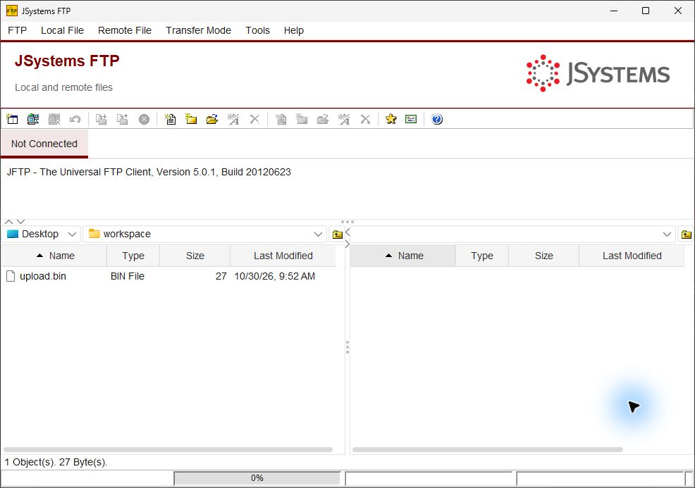
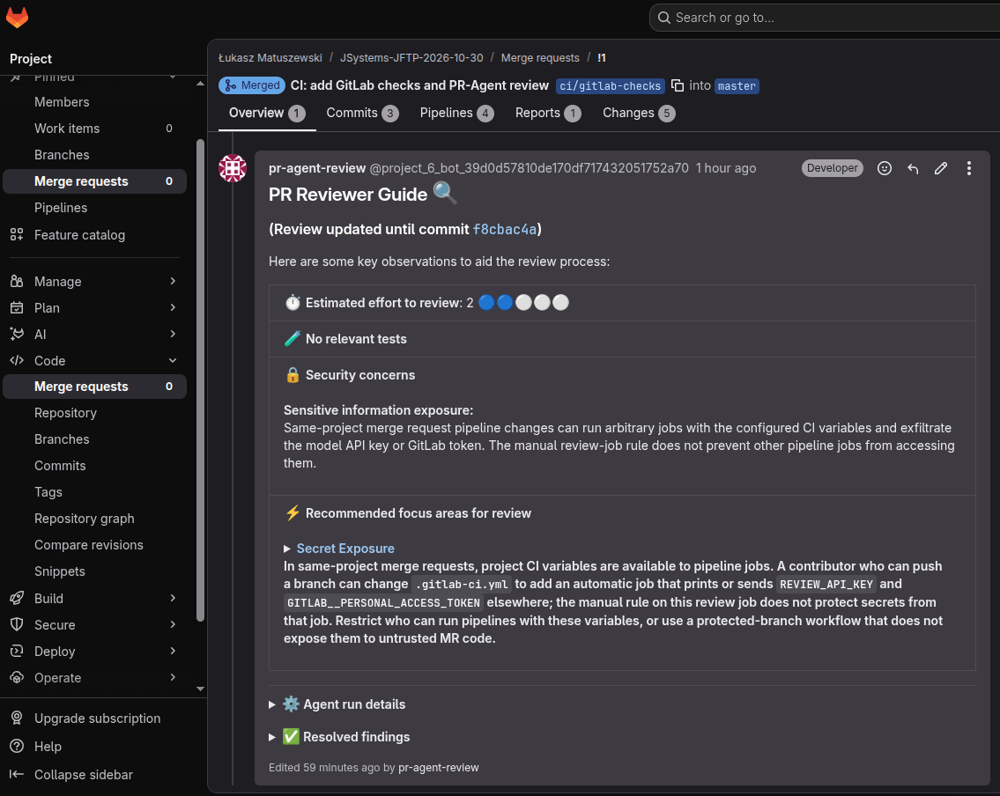

# JSystems FTP — course repository

## Updates — 30 October 2026

- [Directory Assistant PRD](docs/prd/directory-assistant.md): requirements for a proposed read-only AI assistant that answers questions about explicitly attached directory listings.
- [Local directory chat implementation plan](docs/plans/directory-assistant-local-chat-implementation-plan.md): the first delivery slice, task dependencies, testing and verification gates. Implementation has not started.
- [Implementation Planning skill](.agents/skills/write-implementation-plan/SKILL.md): creates and audits implementation plans from accepted PRDs and ADRs, with explicit approval gates before implementation.
- [GitLab CI/CD](.gitlab-ci.yml): Checkstyle linting, headless unit tests and manual PR-Agent merge-request reviews. See [setup and live verification](docs/gitlab-pr-agent.md).
- [Example AI review on a GitLab merge request](#gitlab-cicd-and-ai-code-review): the PR-Agent comment on merge request !1, with a screenshot below.

This repository is the working example for the JSystems course on AI-assisted
software development. We use an existing Java/Swing FTP client to practise
understanding legacy code, writing regression tests, documenting decisions,
and refactoring an application in small, verifiable steps.

JFTP browses local and remote files, connects over FTP and FTPS, uploads and
downloads files and directories, and manages connection favorites and session tabs.
The application itself does not require an AI service or API key.

## Application after the visual refactor



Captured on 30 October 2026 from the local refactor candidate. The workspace has
a JSystems logo on the right, burgundy accents, a light theme, and English labels.
The visual refactor is still in the local working tree and is not part of this
documentation commit; a fresh clone currently opens the earlier interface.
See the [branded desktop specification](docs/prd/branded-desktop.md) and
[verification record](docs/testing/branded-desktop.md) for scope and acceptance status.

## Start here as a course participant

You need Git, JDK 25 with `java` and `javac` on your PATH, and a graphical desktop.
The documented build and launcher checks were performed on Windows with PowerShell.
Maven is provided by the wrapper. The first build needs HTTPS access to Maven
Central and the FTPAPI publisher repository.

Clone this course repository and enter its directory:

```powershell
git clone https://github.com/LucasMatuszewski/JSystems-JFTP-2026-10-30.git
cd JSystems-JFTP-2026-10-30
```

Run the local tests, then build the distribution:

```powershell
.\mvnw.cmd test
.\mvnw.cmd package
```

`package` also runs the local tests. Real FTP/FTPS suites use separate fixtures;
they are not implied by a passing local test run. The compiler currently targets
Java 8 bytecode (`--release 8`), even though the course build uses JDK 25.
See [build instructions](docs/build.md) for dependencies and known build warnings.

Extract the ZIP and start the application:

```powershell
Expand-Archive -LiteralPath .\target\jftp-5.0.2-SNAPSHOT-bin.zip -DestinationPath .\target\course-app
& .\target\course-app\jftp-5.0.2-SNAPSHOT\jftp.bat
```

Use an empty extraction destination. Keep the extracted launcher, application JAR,
and `lib` directory together. On Unix-like systems the build entry point is
`./mvnw` and the extracted launcher is `sh ./jftp.sh`; Unix and macOS startup
have not been verified for this checkout.

For a first desktop exercise, open and cancel Connect, create a second session
tab, and browse a local folder. For transfers, use an authorized test FTP server
with synthetic files: connect, upload a file, download it to a different local
folder, compare its bytes, then disconnect and reconnect. The
[native FTP walkthrough](docs/testing/native-ftp.md) shows the recorded baseline;
the [FTP](docs/testing/ftp-contract.md) and [FTPS](docs/testing/ftps-contract.md)
guides describe the real test fixtures.

## What to explore during the course

| Material | What to use it for |
| --- | --- |
| [Product requirements](docs/PRD.md) | Understand observed behavior and distinguish it from proposed changes. |
| [Architecture decisions](docs/ADR/) | Read the constraints and reasons behind implementation choices. |
| [Source context guide](docs/source-context.md) | Choose a useful starting point before reading individual source files. |
| [RepoMap](docs/repo-maps/README.md) | Navigate selected class and method declarations. |
| [Code graph](docs/code-graph/README.md) | Explore relationships in an offline browser viewer and compare them with source-checked callers. |
| [Focused Repomix pack](docs/repomix/README.md) | Read full source and comments for the selected connection/transfer workflow. |
| [Design guidance](docs/design-guidelines.md) | Compare visual changes with the supplied JSystems reference. |
| [Verification records](docs/testing/README.md) | Review what was actually tested, how, and with which limitations. |
| [Agent instructions](AGENTS.md) and [skills](.agents/skills/) | Inspect the development workflow and reusable agent guidance used in this project. |

Python 3.12 or newer is needed only for the repository's context and verification
helpers. Node.js 22 or newer with npm is additionally needed to regenerate the
Repomix pack; neither is required to build or run JFTP.

A useful exercise is to trace Connect from its UI action to the FTP client,
compare what the map, graph, and full-source pack reveal, then check the original
definitions and callers. Choose one small change, define its expected behavior,
write a failing test, implement it, and exercise the real application.

Generated context is a saved snapshot, not a live view of the checkout. Follow
each guide's verification and refresh instructions after changing its inputs.
Historical baseline reports retain the results and limitations of their own runs.

## GitLab CI/CD and AI code review

The [pipeline](.gitlab-ci.yml) runs on the course GitLab instance (Docker runner) in two stages:

1. **check**, automatic on every merge request and on `master`: `java-lint` runs Checkstyle with [ci/checkstyle.xml](ci/checkstyle.xml), and `unit-tests` runs `./mvnw clean test` and publishes the JUnit report to the merge request.
2. **review**, started manually after the checks pass: `pr-agent-review` runs community PR-Agent 0.47.0 (image pinned by digest), sends the merge-request diff to a model through OpenRouter and posts a review comment. The review is advisory and never blocks the merge.

It needs two CI/CD variables, `REVIEW_API_KEY` (OpenRouter) and `GITLAB__PERSONAL_ACCESS_TOKEN` (a project bot token that posts the comment). Setup, security notes and the live verification are in [docs/gitlab-pr-agent.md](docs/gitlab-pr-agent.md).

Example: the PR-Agent review on merge request !1 (`ci/gitlab-checks` into `master`). The agent estimated the review effort and flagged a real risk in this setup: in same-project merge requests any pipeline job can read the CI variables, so the manual rule on the review job does not protect the API key or the token.



## Repository layout

```text
src/main/java/       Swing application, shared components, and ZIP helpers
src/main/resources/  Application resources
src/main/images/     Legacy application icons and images
src/main/help/       JavaHelp documentation
src/main/distribution/  README shipped with the packaged application
src/test/java/       Java regression and integration tests
tests/              Python checks for repository tools and packaging
tools/              Build, test-fixture, and source-context helpers
assets/             JSystems logo, tokens, and visual reference
docs/               Requirements, decisions, course guides, and evidence
.agents/skills/     Reusable agent skills
```

## Known limitations and attribution

Legacy FTPS trust handling does not establish full PKIX and hostname validation,
and favorites encryption relies on an embedded key. Archive extraction hardening
is a separate planned change in [ADR-005](docs/ADR/005-contained-archive-extraction.md).
Use the [architecture record](docs/ADR/000-main-architecture.md) for the known
security limitations; historical platform and protocol claims are not compatibility
guarantees for this checkout.

This course project builds on JFTP by Sai Pullabhotla and contributors. The
original code is licensed under [Apache License 2.0](LICENSE.txt); preserve the
[original notice](NOTICE.txt). Supplied brand assets have separate
[provenance and reuse notes](assets/README.md).
