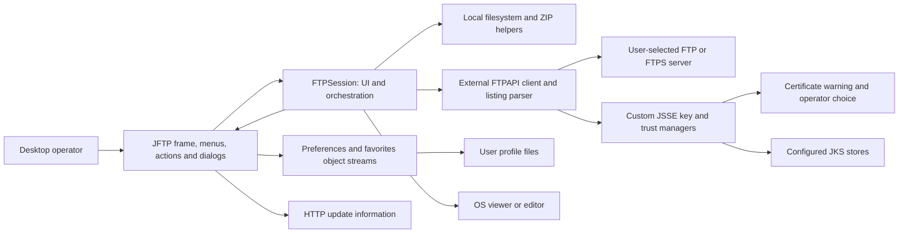
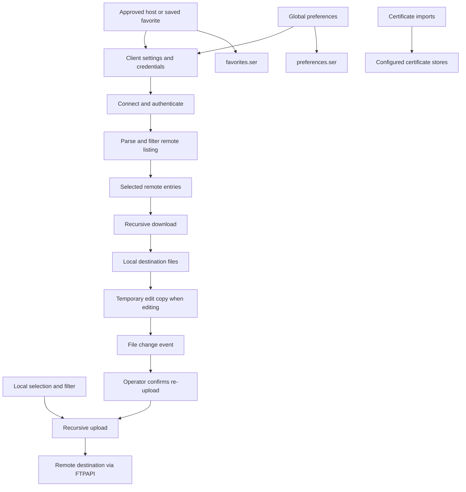
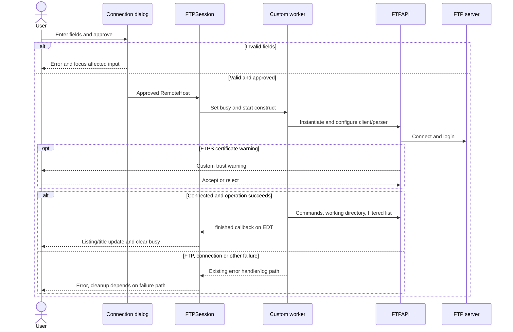
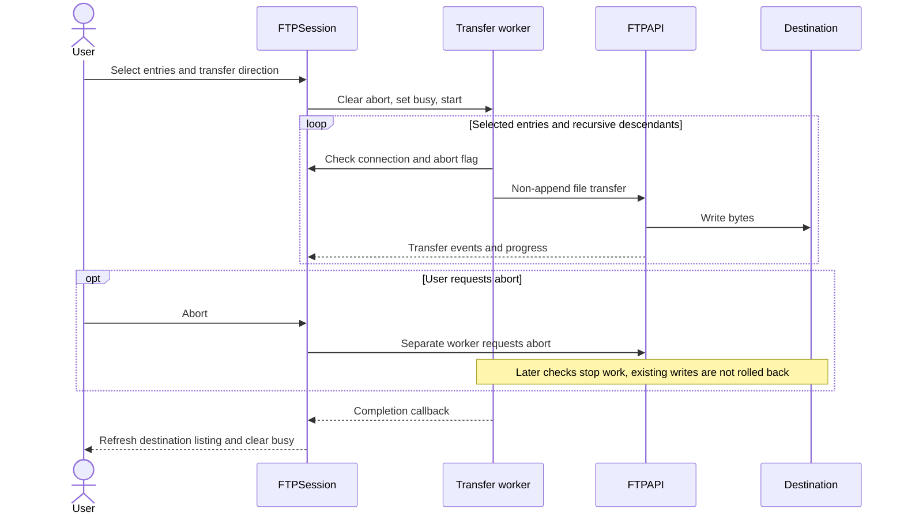
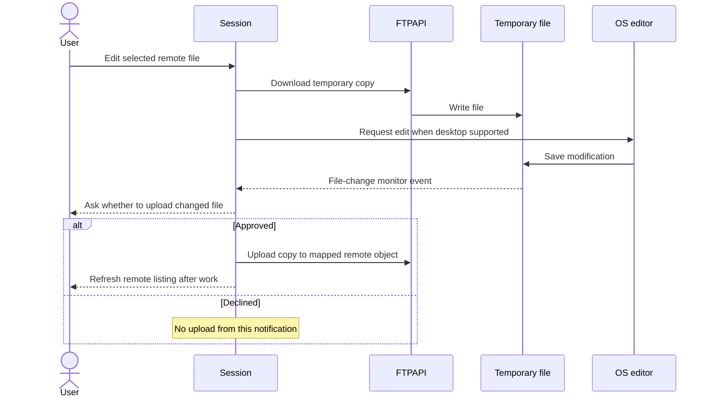
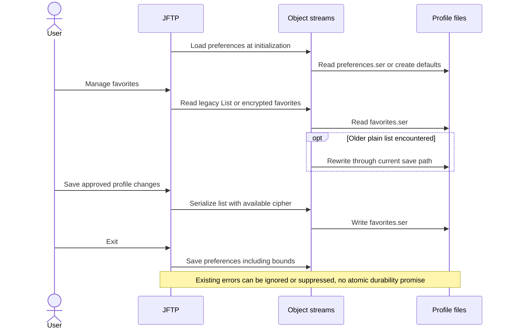

# ADR-000 — JFTP current architecture

**Date:** 2026-10-29  
**Status:** Observed baseline, retrospective; not approval of the legacy security design.  
**Product description:** [PRD](../PRD.md)  
**Source baseline:** `14e62ceba4e371c2a0b955604b10f065f46f4f7d`  
**Verification and change gate:** [ADR-001](001-baseline-verification.md)

## 1. Overview and autonomous intake

This record explains the existing desktop application's structure, storage and external boundaries before any major modernization. It records mechanisms found in the source, rather than reconstructing undocumented historical intentions. Source inspection is complete for the paths cited below; a successful complete build, native startup and FTP/FTPS run have not yet been demonstrated.

The user requested both product and technical descriptions and explicitly asked the agent to answer the skills' intake questions autonomously. The PRD was written and read before this record. Its pending runtime confirmation is carried into this ADR.

| Technical intake question | Answer established from this checkout |
|---|---|
| What language, framework and runtime are present? | Java with Swing/AWT and custom GUI widgets; Maven declares source/target 1.5. Installed JDK 25 cannot compile with those options. |
| Which libraries are selected? | FTPAPI 3.0.0, JavaHelp 2.0.05 and test-scoped JUnit 3.8.1 are declared; declaration alone is not proof of a working build. |
| Where is the application deployed? | Desktop JAR plus dependencies, launch scripts and archive assemblies. Applet and old macOS integration also remain in source; present support is unknown. |
| Where is data stored? | Per-user files under the Java `user.home` directory, plus configured certificate stores and temporary edit copies; no database is established. |
| What external systems does it use? | User-selected FTP/FTPS servers, an HTTP update-information URL, and OS desktop handlers. SOCKS preferences change JVM-wide networking state. |
| What performance commitments exist? | No measured throughput, maximum file size, concurrency limit or latency SLA was found. Progress uses integer values despite long byte counts. |
| What security mechanisms exist? | User/password/account login, optional FTPS, custom certificate warning logic and legacy serialized storage with an embedded-key encryption mechanism for favorites. These require review, not a modern-security claim. |
| What must protect modernization? | The user's characterization-first workflow, real desktop/server verification and scoped commits; see ADR-001. |

## 2. Technology documentation references

No Context7 ID was supplied or verified. For this retrospective record, the exact checked-in implementation and downloaded matching dependency sources are more specific evidence than documentation for a newer release; official references supplement them. No dependency version is being selected or upgraded in this ADR.

| Technology | Official reference | Purpose and limits |
|---|---|---|
| Java Swing | [Java SE 25 Swing package](https://docs.oracle.com/en/java/javase/25/docs/api/java.desktop/javax/swing/package-summary.html) | EDT policy; does not prove this legacy UI is thread safe |
| Maven | [Maven 3.8.1 HTTP repository change](https://maven.apache.org/docs/3.8.1/release-notes.html) | Explains default blocking of external HTTP repositories; not a recorded full Maven run |
| FTPAPI 3.0.0 | [Publisher's matching binary/source downloads](https://www.jmethods.com/ftpapi/download.html) | Matching API source and implementation evidence; hashes in dependency register D-01/D-02 |
| Java serialization | [Java SE 25 serialization specification](https://docs.oracle.com/en/java/javase/25/docs/specs/serialization/index.html) | Terminology for persisted object streams; current source remains the contract for legacy classes |
| JavaHelp | [Declared dependency and packaging](../../pom.xml) | Version and inclusion are source-derived; help rendering is not yet verified |

## 3. System architecture and repository

JFTP is a single-process desktop monolith. `JFTPApplication` selects locale/look-and-feel, creates the `JFTP` frame, makes it visible and creates the first `FTPSession`. `JFTP` owns tabs, global preferences, client/parser registries, menus and toolbar. Each `FTPSession` combines Swing presentation, connection state, transfer orchestration, recursive operations, event listeners and error reporting. There is no independently deployed backend or application HTTP API in the inspected paths. [CS-01–CS-03, CS-07]

| Area | Existing technology/responsibility | Why present |
|---|---|---|
| Desktop presentation | Swing/AWT, `com.myjavaworld.gui` widgets, action classes | Directly constructs the current frame, panes, menus and dialogs |
| Application/session logic | `com.myjavaworld.jftp`, including `JFTP` and `FTPSession` | Owns user actions, settings and active connection state |
| Protocol | External FTPAPI 3.0.0, selected clients and listing parsers | Supplies FTP transport, remote models, listing and filter interfaces |
| Encryption/certificates | JSSE plus `jftp.ssl` classes and JKS stores | Creates custom key/trust managers and operator warning flow |
| Persistence | Java object serialization and key stores | Retains preferences, favorites and certificates |
| File helpers | `com.myjavaworld.util`, `LocalFile`, `com.myjavaworld.zip` | Filesystem monitoring, metadata, recursion and archive operations |
| Build/distribution | Maven plugins, assembly descriptor, shell/batch launchers | Packages JAR/resources/dependencies and distribution archives |

The table describes existing responsibility, not a recovered rationale for selecting each technology. Historical tradeoff discussions are unavailable.

Source roots include `src/main/java`, language resources in `src/main/resources`, `_de` and `_zh_TW`, images in `src/main/images`, JavaHelp under `src/main/help`, launcher templates under `src/main/scripts` and assembly metadata under `src/main/assembly`. The original `src/test` roots contain placeholders and no Java tests. New `tools/`, `tests/`, `docs/` and `assets/` artifacts assist this takeover and are outside the desktop runtime. [CS-24]

## 4. Dependencies and threading

The main direction is actions/dialogs → `JFTP`/`FTPSession` → FTPAPI, filesystem and TLS helpers. Dependencies also point back: a session holds its frame reference and updates its toolbar/title. This creates actual UI/application coupling; it must not be represented as a clean acyclic service architecture.

The session selects an external client and parser by class name using reflection. Built-in registries include default/AS400 clients and Unix/DOS listing parsers. Those class names are part of saved profile compatibility, not interchangeable implementation details. [CS-02, CS-07, CS-26]

The repository's `com.myjavaworld.gui.SwingWorker` is a custom class, not `javax.swing.SwingWorker`. Its `construct()` runs on a new thread; normal completion schedules `finished()` on the EDT. Existing workers also update status and other state inside `construct()`, and startup creates the UI directly from `main`. Both need a thread-confinement audit: Oracle's Swing documentation requires EDT access unless a component documents otherwise. A deferred `finished()` callback does not make all work thread safe. [CS-01, CS-07, CS-27]

Session timers track elapsed time and progress. Transfer work is sequential within each selected-entry loop and recursive for directories. Several tabs can hold clients, but no measured concurrency guarantee or central bounded executor has been established. A boolean busy flag is not evidence of synchronization or transactional operation ownership. [CS-09–CS-11]

## 5. Data and persistence models

| Model | Significant state | Lifetime/storage |
|---|---|---|
| `JFTPPreferences` | Locale/LAF/theme, window bounds, local directory, email, client/parser names, timeouts/buffers, transfer map/default, proxy and certificate-store settings | Global in-process object; `user.home/.jftp/data/preferences.ser` |
| `RemoteHost` / `Favorite` | Name, hostname, port, username, password, optional account, client/parser class names, passive flag, command array, initial directories and FTPS mode/port/data-encryption flag | Retained per-session host; favorites list in `favorites.ser` |
| `FTPSession` | FTP client/parser, local/remote working directories, selections/panes, filters, abort state, transfer type, timers and monitored transfers | In-memory session; no tab/connection restoration contract established |
| `LocalFile` / external `RemoteFile` | Local file handle or parsed remote identity, type, name/path, size, timestamps and attributes | Directory listing and operation state; remote shape depends on chosen parser |
| `TransferObject` | Transfer direction and corresponding local/remote objects | In-memory mapping for monitored temporary edit files |
| Certificate stores | Server trust certificates and client key/certificate material | Configured JKS files; lazily cached by `KeyStoreManager` |

Preferences are written using object streams. Missing preferences create defaults. Loading catches selected class/type errors and returns preferences from a `finally` block; this can suppress pending exceptions. Exit ignores save exceptions. Therefore the current implementation does not guarantee durable settings or visible error reporting for every persistence failure. Do not silently change serialization compatibility or treat every load failure as an empty user profile. [CS-04, CS-20, CS-21, CS-28]

Favorites load either an older serialized list or a `SealedObject`; loading an old list rewrites it. Saving uses AES with key bytes embedded in source, and falls back to an unencrypted serialized list if a cipher is unavailable. This is neither an OS credential vault nor user-secret encryption. Do not read real user favorites, proxy credentials, passwords or certificate keys for tests. No real user data was inspected for this document. [CS-19]

## 6. Interface contracts and side effects

| Boundary | Inputs and result | Failure/state contract |
|---|---|---|
| Connect dialog → session | Approved `RemoteHost`, or no approved host on cancel; required nonblank host/user/password; UI accepts ports 0–65535 | Invalid fields display an error; no connection initiated by cancellation. Ordinary port setter maps nonpositive values to FTP default; implicit port setter retains its supplied value. |
| Session → FTP client | Reflectively constructed client/parser, settings, connect/login, configured commands, working-directory selection, listing | FTP, connection and generic errors use distinct handlers. Completion updates the pane if still connected and clears busy state; cleanup is not uniform across all paths. |
| Upload/download | Selected entries and working directories; recursively dispatch regular files | Non-append transfer requests, upload starts at byte zero. Download can replace an existing local file. Remote replacement remains server-dependent. Failure/cancel is not atomic and can leave partial writes. |
| Listing/filter | Parsed remote entries and optional external `Filter`; local wrappers and local filter | Filters affect listing/traversal. Parser errors can print original listing details to the status log. Directories pass name/date filters; local hidden/exclusion handling needs characterization. |
| File management | User-entered names, selected objects, confirmation and optional recursive permissions | Local Java filesystem result or server command/reply drives updates. Deletion is destructive. `SITE CHMOD` depends on the server; error reporting differs between paths. |
| Remote edit → desktop | Temporary downloaded file, OS edit handler, file-change event | Edit monitoring asks before upload. Unsupported desktop integration or failed download can prevent opening. Temporary copies are marked for deletion on exit, not guaranteed secure erasure. |
| Preferences → JVM networking | SOCKS host/port and optional credentials | `JFTPUtil.updateProxySettings()` changes system properties and the default `Authenticator`, affecting the whole JVM rather than just one session. |
| Updater → external URL | HTTP properties containing `latestVersion` and `infoURL` | Initial delayed request, lexicographic version comparison, informational dialog; failures print a stack trace and retry after five minutes. No binary install step identified. |

Evidence: [CS-05–CS-23, CS-26, CS-29; D-01/D-02](../current-state-evidence.md).

### TLS boundary and known hazards

`JFTPSSLContext` requests the generic `SSL` context and supplies custom key/trust managers. The server trust path checks the first certificate's validity dates, compares its subject CN with the hostname and checks whether any supplied certificate is present in the local trust store. It does **not** call its delegate's `checkServerTrusted`; the client trust method does delegate. Invalid/unrecognized server trust can be overridden in a warning dialog, and an identical previously accepted chain is cached. SAN/wildcard/PKIX validation must not be claimed from these checks. Actual negotiated protocols/ciphers remain unmeasured. [CS-23, CS-30]

The ZIP extraction helper combines the target directory with archive entry names without a containment check before creating/writing paths. This is a source-identified path traversal risk, reachable from the download-and-unzip action. It requires a separate failing regression test and an intentional security fix; it is not acceptable as a future preserved requirement. No malicious archive was run against real user directories. [CS-12, CS-31]

## 7. Runtime, build and distribution constraints

There is no established required application environment variable or LLM API key. Java `user.home` controls the profile location. Desktop edit/view depends on OS handlers; networking depends on selected host and proxy settings. Tests must use an isolated synthetic profile and local directories.

The POM declares version `5.0.2-SNAPSHOT`, while `JFTPConstants` displays `5.0.1` with build `20120623`. The artifact and About version therefore are not a single source of truth. Compiler plugin 2.4 requests source/target 1.5; JDK 25 rejects those options in a minimal compiler probe. This proves that option mismatch, not a complete application compilation failure report. Maven was not on PATH during the baseline inventory; no successful full package/test run has occurred. [CS-24, CS-32]

FTPAPI's original POM repository uses HTTP, which modern Maven normally blocks. On 2026-10-29 the publisher's equivalent **HTTPS** location served the matching POM, binary and source JAR successfully; hashes are recorded in D-01. This resolves availability of those artifacts only. It does not prove all transitive artifacts, JavaHelp, old plugins or the complete assembly resolve. The checked-in POM remains unchanged. [CS-24, D-01; Maven reference above]

The JAR manifest names `com.myjavaworld.jftp.JFTPApplication` and uses a `lib/` classpath prefix. The assembly puts the project JAR at its distribution root and dependencies in `lib`; however the current launchers refer to `lib/jftp-${project.version}.jar`. This apparent path mismatch must be verified in the actual generated distribution before advertising the launch scripts as working. Maven package also binds the assembly; release/deploy/tag goals must not be invoked as part of local baseline checks. [CS-24, CS-33]

## 8. Recorded decisions and consequences

### Preserve a factual pre-change baseline

**Status:** Accepted for this takeover by the user's instruction, 2026-10-29.  
**Context:** A modernization can accidentally turn inferred features into promised behavior or erase legacy compatibility constraints.  
**Decision:** Freeze the source baseline in this PRD/ADR/evidence set, distinguish observations from runtime confirmation, and require characterization before changing production behavior.  
**Alternatives:** A web rewrite is outside the user's selected direction. An immediate broad source/dependency upgrade lacks a trustworthy regression baseline.  
**Consequences:** (+) Reviewers can distinguish retained behavior from intentional fixes. (−) Build recovery and baseline verification precede visible modernization.  
**Review trigger:** Verified runtime evidence contradicts a source-derived requirement, or a scoped change is approved.

### Retain the desktop application and modernize in increments

**Status:** Accepted direction from the user, 2026-10-29; no replacement framework/version selected here.  
**Context:** The implemented value is the desktop local/remote workspace and server integration.  
**Decision:** Preserve that delivery model while recovering the build and adding testable boundaries in scoped changes. Existing Swing/FTPAPI/serialization mechanisms are **observed legacy mechanisms**, not newly approved architectural choices.  
**Alternatives:** A new browser product and an untested all-at-once dependency/transport replacement are outside this initial scope. Historical reasons for the current libraries and formats are unknown.  
**Consequences:** (+) Existing workflows and profile compatibility can be checked incrementally. (−) Tight UI/session coupling, reflection, old data formats and unsafe paths remain work to address explicitly.  
**Review trigger:** A verified compatibility/security constraint forces a transport, persistence or UI boundary change.

## 9. Diagrams

### Components and trust boundaries

### Transfer and retained-data flow

### Connection and failure sequence

### Transfer, abort and completion sequence

### Remote editing sequence

### Favorites and preferences sequence

Update checking is a separate background request described in section 6; no application binary-install flow exists to diagram. Session restart restoration and a server-side application database are not established flows.

## 10. Testing strategy and limitations

[ADR-001](001-baseline-verification.md) defines the required characterization, controlled mutations, integration and native UI verification gates. Those gates are planned validation work, not existing passed application tests. Every subsequent ADR/change must identify the affected PRD acceptance criteria, preserve or explicitly revise them, and refresh source-context snapshots after relevant source/dependency edits.

Open points are current OS/macOS/applet support; actual FTPS protocol/cipher compatibility; large-file progress overflow; recursive links/path semantics; interruption and concurrent operation races; serialized-profile compatibility and corruption behavior; parser correctness; JavaHelp operation; and a working packaged launcher. None is resolved merely by a successful compile.
