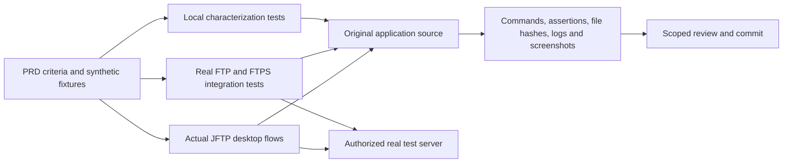
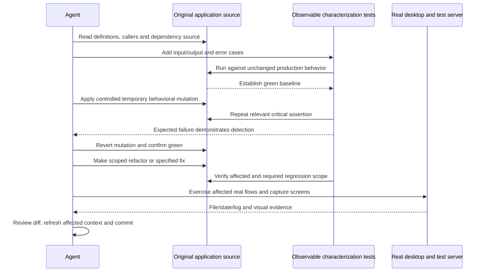

# ADR-001 — Establish evidence before modernization

**Date:** 2026-10-29

**Status:** Accepted workflow from the user's instructions; application verification remains pending.

**Relates to:** [Current architecture](000-main-architecture.md), [PRD](../PRD.md), [repository workflow](../../AGENTS.md)

## 1. Scope

This record defines how to establish a trustworthy regression baseline and distinguish historical behavior from an intentional fix. It does not assert that the current application builds, starts, transfers files or satisfies all PRD criteria. It does not choose a new Java version, FTP library or UI framework.

## 2. Evidence and documentation

The [evidence register](../current-state-evidence.md) ties current-state claims to exact original files and ranges, with file hashes and quotation checks. Repository maps, extracted graph edges and Repomix packs provide navigation/context; none supersedes the original source or proves runtime behavior.

| Reference | Use |
|---|---|
| [PRD acceptance criteria](../PRD.md#6-acceptance-criteria) | Observable baseline expectations, explicitly source-derived |
| [ADR-000 references](000-main-architecture.md#2-technology-documentation-references) | Exact dependency and current platform documentation |
| [RepoMap plan](../repo-maps/jftp-modernization-plan.md) | Prioritized investigation and context-tool guidance |
| [Graph guide](../code-graph/README.md) | Offline graph, verified caller overlay and limits |
| [Repomix guide](../repomix/README.md) | Scoped complete connection/transfer source context |

No Context7 ID has been verified. Future library/version decisions must check the exact selected version's official documentation or resolve its Context7 ID, rather than assume today's API matches FTPAPI 3.0.0 or Java 1.5-era code.

## 3. Current verification status

| Layer | Observed result as of this document | Limits |
|---|---|---|
| Application test inventory | No Java tests in the original test roots; JUnit 3.8.1 declared | Declaration is not executed coverage |
| Compiler option probe | Installed JDK 25 rejects source/target 1.5 | Small standalone probe only; no complete application compilation claimed |
| Dependency recovery | Matching FTPAPI POM/binary/sources downloaded over HTTPS and hashed | Not a complete dependency or plugin resolution |
| Repository tools | Repomix CLI checks and source/graph evidence verification have passed; timer CLI checks passed | These validate developer tools, not the Java client |
| Native JFTP startup | Pending | No application screenshot or manual acceptance pass yet |
| FTP/FTPS behavior | Pending | No successful server connection, authentication, transfer or negotiated TLS result claimed |

Future evidence must record date, source revision, exact command/runtime, output, test discovery counts, failures and skips. Compilation, tests, startup and end-to-end behavior must be reported separately. A skipped test or tool test cannot count as an application regression pass.

## 4. Baseline design and data

Use an isolated synthetic Java user profile, owned temporary directories and an explicitly authorized test server. Fixtures contain synthetic files/credentials only. Never load the operator's real favorites, proxy secrets, certificate private keys or production server state to discover application behavior.

Retain a source-clean reference while recovering the build. If restoring a viable test runner requires a POM/build-only change, commit and describe it separately, prove the application source stayed unchanged, and first run characterization against that original source. Record any temporary command-line compatibility settings. Do not call a changed transport, new trust policy or rewritten persistence format a baseline.

Use real filesystem fixtures for local models, filters, ZIP operations and serialization. Preserve legacy serialized identifiers and synthetic fixtures where compatibility matters. If external service/database mocks are ever needed, follow AGENTS.md's fresh real capture requirement; no invented endpoint/database responses. Integration/E2E FTP tests use a real authorized server, including its actual replies and file state.

## 5. Interface and outcome contracts

Every scenario records input files/settings, action, observed resulting files/state, errors, and whether behavior was source-derived or runtime-confirmed. Binary transfer success requires byte equality, not just a completed progress bar. ASCII transfer cases record the expected line conversion separately. Abort/error checks inspect retained partial files and connection/UI state, rather than infer rollback.

For suspected defects, preserve the factual observation and create separate intended-change criteria. Unsafe archive paths, legacy trust checks and insecure credential storage are not requirements to preserve indefinitely. A fix needs a failing test for its intended rule and an explicit record of changed compatibility.

## 6. Decision

**Status:** Accepted user-directed workflow, 2026-10-29.

**Context:** There is no established Java regression suite, and the old build declares unsupported compiler options on this machine. Broad changes would make regressions difficult to distinguish from pre-existing behavior.

**Decision:** Recover build/test access without initially changing application behavior; add green characterization of the unchanged source; show critical assertions detecting controlled behavioral mutations; then refactor in small verified steps. For new features and intentional bug/security fixes, run Red → Green → Refactor against the agreed specification.

**Alternatives:** Tests written only after a broad rewrite cannot establish baseline equivalence. Tests asserting only private layout or mirroring implementation do not sufficiently protect observable behavior. A compile-only gate misses server, file and desktop failures.

**Consequences:** (+) Evidence can distinguish a retained quirk from a corrected defect. (−) Build recovery and controlled runtime setup take time before visual changes.

**Review trigger:** Any baseline observation contradicts a PRD criterion, or a source/dependency change invalidates fixtures or saved context.

## 7. Diagrams

### Verification components

### Characterization and change sequence

The evidence flow is the component diagram's output path. There is no external application database or invented API response model in this strategy.

## 8. Test layers and priority scenarios

| Layer | Initial scope | Tools/constraints |
|---|---|---|
| Local characterization | File metadata/filtering, host normalization/defaults, transfer type mapping, synthetic persistence, ZIP round trips | Choose a viable Java test runner during build recovery; use actual owned filesystem fixtures and observable results |
| Integration | Real login/list/upload/download, active/passive as supported, both FTPS modes, real parser and certificate conditions | Authorized local/test FTP server, synthetic credentials, actual dependency and file checks; no mocked FTP server responses |
| Native desktop E2E | Startup, connection validation/cancel, two sessions, transfers/abort/reconnect, preferences/favorites and edit flow | Real native windows and real server; record screenshots and resulting state |
| Repository tooling | Snapshot integrity and scoped CLI behavior | Existing Python checks, exact pinned generation tools and offline graph interaction checks |

| Scenario | Inputs/actions | Required observation | Edge cases |
|---|---|---|---|
| Host and connection validation | Empty fields, cancel, ports -1/0/65535/65536 | Approval/error result, ordinary-vs-implicit port normalization | Zero currently accepted by UI; server result separate |
| Filters and types | Real files/directories; regex/date/include/exclude; mapped/unmapped extensions | Exact accepted entry set and selected transfer type | Hidden/exclusion inversion; directories bypass name/date filters |
| Transfer integrity | Synthetic binary/text files and nested directories | Destination bytes/line conversion and refreshed pane | Existing destination, spaces/non-ASCII names, empty files, server rejection |
| Abort/error recovery | Cancel during a larger transfer; failed authentication; server disconnect | Stop behavior, partial destination, status and reconnect outcome | Multiple tabs and connect/disconnect races |
| Profile compatibility | Synthetic defaults, saved preferences, old/plain and sealed favorites | Retained fields and identified error/rewrite behavior | Corrupt/truncated data and cipher-unavailable path |
| Trust behavior | Controlled valid/expired/mismatched/unrecognized certificates | Warning, reject/override result and actual negotiated TLS | Same-chain cache, CN-vs-SAN behavior; separate future security rules |
| ZIP behavior | Benign round trip, nested entries, then controlled traversal case in owned sandbox | Exact output paths/content and demonstrated unsafe baseline or intended guard | Empty/unknown entry sizes and cancellation; never extract test traversal into real user paths |
| Native editing | Controlled remote text file and supported editor association | Temporary copy, change prompt, approve/decline and remote bytes | Unsupported editor, failed download, repeated changes |
| Distribution startup | Actual package assembly and launchers | Correct JAR location/classpath/resources and visible main window | Launch from a different working directory; help resources and locale |

## 9. Technical acceptance gates

- **TAC-01:** The baseline record identifies the exact application revision and distinguishes build, Java tests, tooling tests, startup and server verification.
- **TAC-02:** Before production refactoring, affected characterization tests pass against unchanged application source and critical cases detect a reverted controlled mutation.
- **TAC-03:** A deliberate behavior fix has a specification-backed failing test before its production change; existing assertions are not weakened to hide a failure.
- **TAC-04:** Binary transfer checks compare source/destination bytes; a status message alone cannot satisfy them.
- **TAC-05:** Runtime changes pass native startup and the affected real flow; every touched screen has a screenshot compared with the supplied brand reference when branding applies.
- **TAC-06:** Test profiles and files contain only synthetic data and remain in owned directories; no real user credentials or private key files are captured.
- **TAC-07:** Each commit passes the relevant scope checks, has a reviewed focused diff and refreshes affected source-context snapshots. No push occurs without instruction.

These are gates for upcoming work, not a declaration that the present application has passed them.
