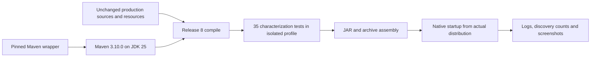
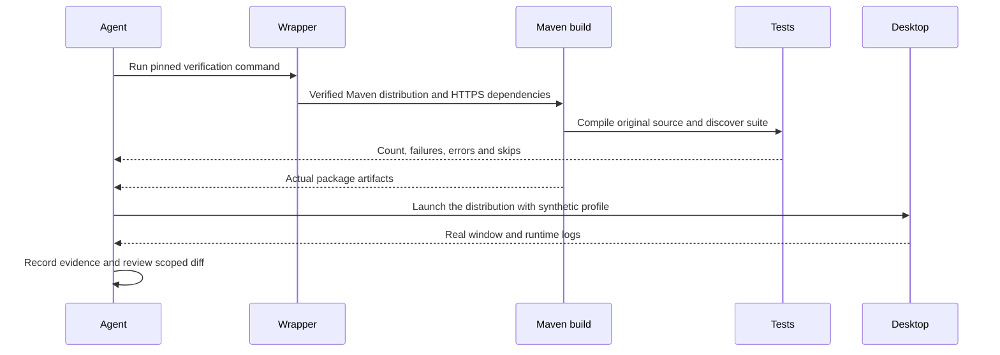

# ADR-002 — Recover the Maven build before runtime refactoring

**Date:** 2026-10-29

**Status:** Build tooling accepted and CLI-verified; launcher fixes and native distribution verification remain a separate pending step.

**Relates to:** [Baseline architecture](000-main-architecture.md), [test gate](001-baseline-verification.md), [executed baseline](../testing/README.md).

## Scope and self-answered intake

| Question | Answer |
|---|---|
| What is already proven? | The original 35 cases and 13 new persistence cases pass on unchanged production Java. Seven FTP and five explicit FTPS cases pass against real loopback fixtures. Native baseline startup/session controls were observed before this build step. |
| Which build tool should participants use? | Maven Wrapper 3.3.4 pins stable Maven 3.10.0, verified against the publisher's distribution checksum. |
| What Java compatibility applies to this step? | Run on the installed JDK 25; retain release 8 compilation temporarily to match the tested baseline. Raising the application baseline to a current Java release is a later runtime change. |
| How is the unavailable Apple API handled? | Exclude only unreferenced `OSXAdapterOld.java` at compilation. Keep its source and active reflection adapter unchanged. This does not certify macOS support. |
| How do the existing tests run with current Surefire? | Upgrade the test dependency to JUnit 4.13.2, retaining TestCase sources initially; pin Vintage 5.14.4. Surefire 3.6.1 requires JUnit 4.12+. All 35 original cases and the new cases must be discovered with zero skips. Jupiter migration is a separate step. |
| What must remain stable? | Production Java, resources, profile formats, user workflows and desktop presentation. Test-framework/build changes must not silently alter those. |
| What is not authorized by local verification? | No release, remote tag, deploy or publishing operation is part of these checks. |

## Decision and dependencies

Use the generated script-only Maven wrapper, pin Maven 3.10.0 and its distribution
SHA-256, change the publisher dependency repository to its verified HTTPS URL, and
pin stable compile/test/resource/JAR/source/assembly plugin releases. Versions were
checked against official Maven Central metadata on 2026-10-29; beta releases were
excluded. This step retains FTPAPI 3.0.0 and JavaHelp 2.0.05 so transport/help
replacement is not mixed with build recovery.

| Component | Version |
|---|---|
| Maven | 3.10.0 |
| Wrapper | 3.3.4, only-script |
| Compiler plugin | 3.16.0 |
| Surefire plugin | 3.6.1 |
| Resources plugin | 3.5.0 |
| JAR plugin | 3.5.1 |
| Source plugin | 3.4.0 |
| Assembly plugin | 3.8.0 |
| Transitional test dependency | JUnit 4.13.2 |

Tests receive isolated Java home/temp directories and an English locale. A missing
test suite is a failure. Original release/publishing configuration is not exercised.
The legacy launcher/assembly path mismatch is a separate verified packaging defect
to address with a failing check before changing the launcher templates.

Alternatives considered: keeping HTTP and enabling an insecure Maven override
would preserve a broken default; replacing FTPAPI or Swing now would invalidate
the just-established baseline; selecting Maven 4/plugin beta releases would add an
unnecessary compatibility variable. The temporary release 8/JUnit compatibility
route deliberately precedes the final runtime/test-framework modernization.

Consequences: participants get a pinned normal build path; the existing tests can
check equivalence. Legacy deprecations, serialization, transport/security behavior
and OS integration remain explicit work. Revisit this ADR when raising the runtime
baseline, migrating tests or replacing a runtime dependency.

## Build and evidence flow

## Verification gates

- Build failure before this change is retained in the baseline report.
- Production source/resource diff remains empty for this build-only step.
- The wrapper verifies the pinned distribution, resolves dependencies over HTTPS and reports Maven 3.10.0.
- The normal test run discovers all 48 current local cases, including the original 35, with zero failures/errors/skips and no real user profile access.
- Packaging and native startup are recorded separately; a test pass does not establish that launchers work.
- Any launcher fix first demonstrates the existing mismatch with a failing observable package check.

Build-tool verification uses real CLI compilation/tests/assembly checks. Production
Java, resource bytes and runtime dependency versions are unchanged from the native
baseline; the compiler uses the same release 8 compatibility setting used there.
This build-only record does not claim that changed launcher scripts passed native
manual QA. Their fix remains separate until that check is possible.

## Official technology references

No Context7 ID was supplied or verified; these exact-version publisher sources were used.

- [Maven download and checksum links](https://maven.apache.org/download.cgi)
- [Wrapper goal and distribution checksum option](https://maven.apache.org/tools/wrapper/maven-wrapper-plugin/wrapper-mojo.html)
- [Compiler release option](https://maven.apache.org/plugins/maven-compiler-plugin/)
- [Surefire 3.6 JUnit requirements](https://maven.apache.org/surefire/maven-surefire-plugin/examples/junit.html)
- [Assembly goal](https://maven.apache.org/plugins/maven-assembly-plugin/plugin-info.html)
- [Official plugin metadata repository](https://repo.maven.apache.org/maven2/org/apache/maven/plugins/)
