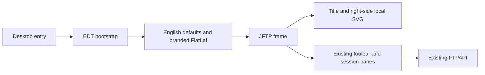
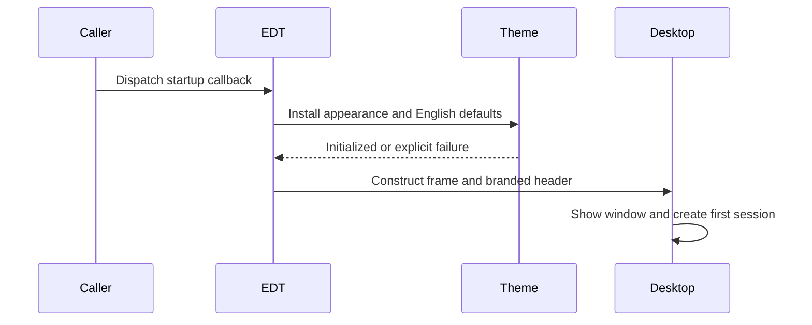

# ADR-003 — Branded Swing workspace and safe desktop startup

**Date:** 2026-10-29
**Status:** Accepted for implementation; verification pending.
**PRD:** [Branded desktop](../prd/branded-desktop.md)
**Relates to:** [Baseline architecture](000-main-architecture.md), [verification gate](001-baseline-verification.md).

## Decision and source findings

Retain Swing and the existing session/transport implementation. Add FlatLaf and
FlatLaf Extras **3.7.2**, the stable release verified from Maven Central metadata
on this date. Extras brings JSVG **2.1.0**, as declared by its published POM, to
paint the original local SVG at display scale. No remote asset request occurs.
Use FlatLaf's documented pure-Java path by disabling its optional native library
before installation. The initial native run exposed a JDK 25 restricted
`System.load` warning from that library. Native window decorations are not needed
for this workspace; use standard OS window frames rather than grant broad JVM
native access. The configuration regression test first fails without this choice.

The current `JFTPApplication.main` constructs Swing windows on the calling
thread. It selects a saved platform look and feel; `JFTP` places its toolbar
directly above the session tabs. `UIPrefsPanel` offers installed look and feels.
`LocalFile` obtains display names and type descriptions from the Windows shell,
which produced Polish labels in the recorded English-locale desktop run.

Create a small desktop bootstrap boundary that runs the startup callback on the
Swing event dispatch thread, directly when already there and queued otherwise.
Install the fixed branded light appearance before constructing any application
components or loading localized application bundles. Force English application
and Swing defaults without rewriting the serialized locale/theme preferences.
Do not claim this fixes existing background-worker Swing mutations elsewhere.

Use a separate header component with application title/subtitle on the left and
the supplied logo on the right. Put that header above the existing toolbar in
the frame's north region. Package only `assets/logo.svg` as a classpath resource
under `com/myjavaworld/jftp/branding`; preserve the original asset bytes.

The fixed appearance uses white surfaces, primary burgundy **#800000**, light
**#E6E6E6** borders, readable Arial 14-point desktop controls with logical-font
fallback, larger header text and 26-pixel file rows. This adapts the approved
website's colors and Arial fallback to a dense desktop workspace; Poppins has not
been supplied as a desktop font and is not claimed to be bundled. Selection and
focus use burgundy with contrasting text. Preserve keyboard actions and toolbar
listeners. Replace the ineffective appearance selector with the fixed theme name.
Regional preferences show a disabled single English locale, retaining date/time
style choices without rewriting the legacy serialized locale field.

Generated local descriptions use `Directory`, `File`, or the uppercase extension
followed by `File`. Display names use real basenames, or the absolute path for a
root lacking a basename. This avoids localized shell aliases while preserving
user path text. Leave icon retrieval, traversal and file operations unchanged.

## Interfaces and data

- Desktop bootstrap consumes one startup callback and dispatches it on the EDT.
- Appearance installation requires the EDT, sets the light theme and English UI
  defaults, and reports initialization failure rather than silently ignoring it.
- Header construction returns a standard Swing panel with accessible application
  and logo labels; logo painting uses the packaged SVG, never a network URL.
- Local file display/type methods keep their return types and underlying file
  identity. Serialized identifiers and preference/favorite formats remain stable.
- No new environment variables, servers, credentials or application data stores.

## Alternatives, consequences and review triggers

A web or JavaFX rewrite would replace the just-verified interaction boundary and
delay the requested incremental modernization. Hand-painting an entire Swing
theme would duplicate maintained UI behavior. Rasterizing the logo would lose
display-scale fidelity. Downloading fonts or assets during startup would make
appearance depend on network availability.

The chosen route adds three runtime JARs (FlatLaf, Extras and JSVG), requires
distribution/classpath checks, and fixes appearance selection for the internal
application. Review this decision if theme switching becomes a requirement or
additional desktop platforms expose layout or native integration differences.
The compiler target remains a separate Java-platform change.

## Diagrams

## Test and acceptance gate

Write tests before production changes and retain the initial failure. Headless
Swing tests exercise actual theme installation, English defaults, EDT dispatch,
logo painting/nonempty bounds and header layout, with no mocks or real windows.
Real-filesystem tests assert exact English type/display output and preserved
filenames. Run all 48 existing cases unchanged, plus real FTP/FTPS component
contracts. Inspect the actual assembled JAR/dependency classpath and original SVG.

Native QA must start the new package with a synthetic existing profile, inspect
the header and Connect/Favorites/preferences dialogs, create/close sessions, and
perform real upload/download. Capture touched screens, compare against the
supplied reference, and check file bytes and logs. Headless layout tests do not
replace native QA. Commit only after these scoped gates pass.

## Verified technology references

No Context7 ID was supplied or verified; publisher documentation and the exact
published POM are the sources for this decision.

| Technology | Official source | Purpose |
|---|---|---|
| FlatLaf | [Setup](https://www.formdev.com/flatlaf/), [custom defaults](https://www.formdev.com/flatlaf/how-to-customize/) | Swing appearance |
| FlatLaf 3.7.2 | [Maven metadata](https://repo.maven.apache.org/maven2/com/formdev/flatlaf/maven-metadata.xml) | Stable version verification |
| FlatLaf Extras 3.7.2 | [Published POM](https://repo.maven.apache.org/maven2/com/formdev/flatlaf-extras/3.7.2/flatlaf-extras-3.7.2.pom), [exact SVG API source](https://github.com/JFormDesigner/FlatLaf/blob/3.7.2/flatlaf-extras/src/main/java/com/formdev/flatlaf/extras/FlatSVGIcon.java) | Local SVG renderer and dependency contract |
| Swing | [Event dispatch thread](https://docs.oracle.com/javase/tutorial/uiswing/concurrency/dispatch.html) | Startup thread contract |
| FlatLaf native option | [Exact-version system properties](https://github.com/JFormDesigner/FlatLaf/blob/3.7.2/flatlaf-core/src/main/java/com/formdev/flatlaf/FlatSystemProperties.java) | Disable optional native library |
