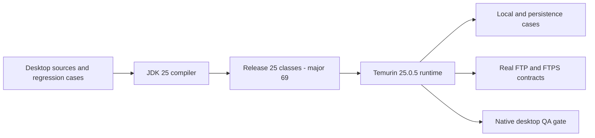
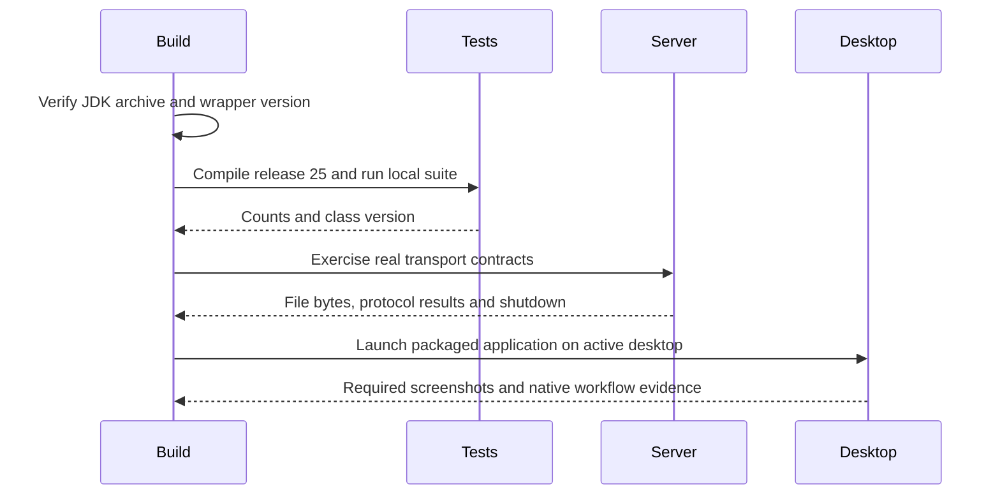

# ADR-004 — Java 25 LTS platform target

**Date:** 2026-10-30
**Status:** Accepted target; CLI compatibility verified. The repository's default
compiler target remains 8 until a separate runtime change passes its native QA.
**Relates to:** [Baseline architecture](000-main-architecture.md),
[build recovery](002-build-recovery.md), [desktop change](003-branded-swing-workspace.md).

## Decision and self-answered intake

Use the current Java 25 LTS line for the internal desktop. Java 27 is a newer
non-LTS feature release; the internal application's supported baseline is the
latest LTS, with its current patch, rather than an untested six-month rollout.
Adoptium's official Windows x64 HotSpot metadata returned **Temurin 25.0.5+8**.
The downloaded JDK archive matched SHA-256
`636bdc13dc649ddc7d5921c5c7d23cca6e44fd19d662b45cc9c02135a6c96c42`.
It was extracted into a private build cache. The global Java installation,
registry and system PATH were not changed.

| Question | Decision |
|---|---|
| Which release line? | Current LTS Java 25; Java 27 compatibility can be evaluated separately. |
| Which patch was actually tested? | Eclipse Temurin 25.0.5+8, published 2026-10-20. |
| How is the build selected? | Existing pinned Maven wrapper, with process-local JAVA_HOME pointing to the verified JDK. |
| What bytecode target is planned? | Release 25, verified as class-file major version 69. |
| What data compatibility applies? | Retain explicit serialized identifiers and existing preference/favorite formats in this platform step. |
| What happens to applets? | Retire the browser-applet entry and the excluded unused Apple-only adapter. The selected product is the desktop application. |
| Which platforms are proven? | Windows CLI only for this target probe. Native desktop acceptance and other OS certification remain separate gates. |
| What blocks the runtime commit? | Windows RDP disconnected during desktop QA; a fresh Java probe reports no desktop access. |

## Boundaries and retirement evidence

Change the compiler baseline and its documented runtime requirement in a focused
step after the branded desktop gate. The release-25 compatibility probe compiles
184 current production files, excluding only the already excluded
`OSXAdapterOld.java`. Its one removal warning is the legacy `JApplet` entry.

In-tree search found `JFTPApplet` referenced only by its own declaration and
launch implementation, and `OSXAdapterOld` only by itself and the compiler
exclusion. The desktop entry creates `JFTP()` directly. Retire those obsolete
sources and their unused build exclusion rather than suppress the new warning.
Review the applet-only boolean constructor/exit path when removing the entry.
Keep the actively called `OSXAdapter` distinct: its macOS callbacks are real
application wiring and require a separate supported-Desktop-API migration.

The platform change preserves connection, transfer and storage behavior. Transport
replacement, certificate-policy correction, archive containment and credential
storage retain their own specifications and tests. A successful compiler/runtime
probe does not complete those modernization requirements.

## Components and compatibility flow

## Verification and acceptance

The [readiness report](../testing/java25-readiness.md) records 62 local cases,
ten real FTP cases and five explicit FTPS cases on JDK 25.0.5 with release-25
application/test classes. These are 77 distinct scoped cases, not native desktop
acceptance. Tests use synthetic files and isolated profiles, with no endpoint
mocks. The existing cancellation mutation experiment also detects an ineffective
abort operation.

Before accepting the runtime implementation:

- The normal wrapper build targets release 25 without a command-line override.
- The application JAR contains release-25 application classes and the expected entry point/dependencies.
- Retired applet/unused adapter sources and their build exclusion are removed; no new removal warning remains.
- Local, persistence and real FTP/FTPS suites retain honest discovery counts and zero skips.
- A real packaged window starts on JDK 25.0.5, and the affected native flows pass with screenshots and byte comparisons.
- Source-context snapshots and development instructions are refreshed for the committed implementation.

## References and review triggers

No Context7 ID was supplied or verified. Exact publisher sources are used:

- [Java support roadmap](https://www.oracle.com/java/technologies/java-se-support-roadmap.html)
- [Adoptium Windows x64 Java 25 metadata](https://api.adoptium.net/v3/assets/latest/25/hotspot?architecture=x64&image_type=jdk&jvm_impl=hotspot&os=windows&vendor=eclipse)
- [Pinned Temurin release](https://github.com/adoptium/temurin25-binaries/releases/tag/jdk-25.0.5%2B8)
- [Compiler release option](https://maven.apache.org/plugins/maven-compiler-plugin/examples/set-compiler-release.html)

Review the patch when Adoptium publishes a newer Java 25 update, the release line
when the next LTS is available, and platform support when a new operating system
is actually exercised. Existing historical baseline reports remain unchanged.
