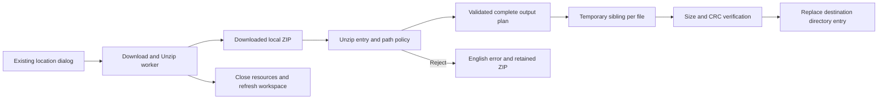
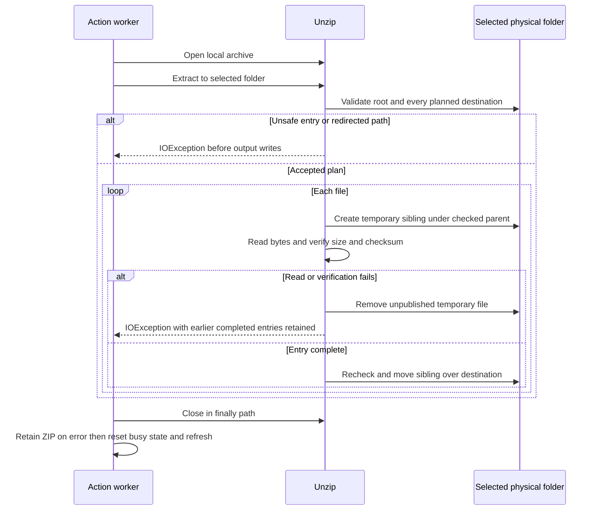

# ADR-005 — Contained archive extraction

**Date:** 2026-10-30
**Status:** Accepted planned design under the user's autonomous modernization
scope. Implementation, failing regression demonstrations and native acceptance
remain outstanding.
**PRD:** [Contained extraction](../prd/archive-containment.md)
**Relates to:** [Baseline architecture](000-main-architecture.md),
[verification workflow](001-baseline-verification.md), [platform target](004-java25-platform.md).

## Scope and verified source

Apply the containment policy inside `com.myjavaworld.zip.Unzip`, so its direct
callers cannot bypass validation. Integrate resource/error handling in
`DownloadAndUnzipAction`. Retain the existing dialog choices and FTP transport.
No new dependency, persistent format or environment variable is required.

Source cards CS-12/CS-31 in the [evidence register](../current-state-evidence.md)
were rechecked against the actual unchanged action/extractor and original
revision `14e62ce`. The action approves locations, downloads, then calls
`unzip.unzip()`; `Unzip.java:134–187` combines names with the target and opens
`FileOutputStream(target)`. The caller closes only after successful extraction.
Its completion callback reports an error, resets busy state and refreshes files.

Separate source findings remain outside this fix: `FTPSession.java:812–833`
catches download errors internally, and extraction does not observe the abort
flag. Do not claim this change repairs download-result propagation or F12 abort.

## Technology documentation references

The Context7 CLI was unavailable and no Context7 MCP tool/verified ID was
available. Official API documentation was checked directly on 2026-10-30.

| Technology | Official reference | Decision informed |
|---|---|---|
| Java Path | [Java 25 Path](https://docs.oracle.com/en/java/javase/25/docs/api/java.base/java/nio/file/Path.html) | Path-component comparison and physical-path checks; normalization alone does not inspect the filesystem |
| Java Files | [Java 25 Files](https://docs.oracle.com/en/java/javase/25/docs/api/java.base/java/nio/file/Files.html) | Read attributes without following links, create temporary output, replace by move |
| Java ZIP reader | [Java 25 ZipFile](https://docs.oracle.com/en/java/javase/25/docs/api/java.base/java/util/zip/ZipFile.html) | Entry enumeration, streams and explicit resource closure |
| Directory-relative operations | [SecureDirectoryStream](https://docs.oracle.com/en/java/javase/25/docs/api/java.base/java/nio/file/SecureDirectoryStream.html) | Race-resistant operations require provider support; do not silently claim that guarantee from ordinary path checks |
| Windows filenames | [Microsoft naming rules](https://learn.microsoft.com/en-us/windows/win32/fileio/naming-a-file) | Device names, reserved characters and ambiguous trailing dots/spaces |

## Component design and data

Retain the public explicit `open`, `unzip` and `close` boundary. Keep policy and
planning helpers internal to the extractor. An extraction plan contains the
original ZIP entry, its relative components, directory/file kind and resolved
destination. It is transient and contains names/metadata, not every file's bytes.

The operator-selected extraction folder must exist. Resolve it once to its
physical absolute directory and use that root for the plan and writes. Resolving
the selected folder itself is intentional; redirects encountered *below* that
root are rejected. This does not authorize writes to a different download path.

Use two phases: validate the complete output plan without creating files or
directories, then extract. An unsafe later entry must not leave earlier valid
entries behind. Runtime I/O errors after validation may leave completed entries;
there is no whole-archive rollback.

## Entry and filesystem policy

- Accept forward-slash relative entry paths. Permit one trailing slash only for
  directory entries. Reject empty names/components, `.` and `..` components,
  rooted/UNC/drive forms and every backslash; do not rewrite unsafe names.
- Use Windows-compatible component rules on every platform: reject ASCII control
  characters, `< > : " | ? *`, trailing dots/spaces, and reserved device basenames
  (case-insensitive, also before an extension): CON, PRN, AUX, NUL, COM1–COM9 and
  LPT1–LPT9, including the documented superscript-digit variants.
- Resolve accepted components against the physical root. Require component-based
  containment and a destination below the root; string-prefix comparison is
  insufficient. Reject output file/directory conflicts and duplicate regular-file
  destinations, including aliases under the filesystem provider's path comparison.
  Repeated directory entries may be coalesced.
- Inspect existing path components with no-follow attribute reads. A symbolic
  link, dangling link or non-directory parent is an error. Resolve existing
  components physically as well and reject redirected paths, including directory
  junctions; an inability to establish the required path/type is an error, not a
  nonexistent-path result. Recheck parents before creation and publication.
- Create missing directories one component at a time under validated parents and
  check their resulting paths. Existing output files must be ordinary regular
  files, never symbolic links, directories or device files.
- Refuse an output destination that is the input archive itself, including an
  existing hard-link alias identified as the same file. The archive must remain
  available until the operation's existing successful-cleanup step.

## File publication and errors

Write each regular entry into a uniquely created temporary sibling in its
validated parent. Count actual bytes and compute CRC-32 while reading; verify
them against the entry's declared size/checksum before publication. This detects
corrupt content; it is not archive authentication. Handle empty entries without
dividing by zero. Keep existing progress/listener integration; wider EDT fixes
remain separate.

After successful reading/verification and a fresh destination check, publish by
a same-directory move with replacement. Never truncate the old destination or
fall back to copying through it. Replacing the directory entry instead of
writing the old inode prevents a pre-existing hard link from changing content
under another name. Move failures are reported. Do not promise crash-atomic
replacement or whole-archive transactions from this portable operation.

Close entry streams and remove unpublished temporary siblings on every failure.
Preserve the primary exception if cleanup also fails. Report unsafe entries as
an `IOException` with a printable escaped entry name and an English reason.
Rejection precedes extraction events/writes; validation itself emits no successful
file-completion events.

The action must close an opened extractor in a `finally` path even if extraction
fails. Delete a temporary downloaded archive only after successful extraction
and closure. On error, retain the archive, show the existing error presentation,
reset the busy/status state and refresh the local pane. Do not broaden this
change into replacement of the legacy worker infrastructure.

## Threat boundary, alternatives and review triggers

This change handles hostile archive names/content and pre-existing links in an
otherwise stable destination tree. A process actively renaming/replacing parent
directories during extraction is outside its guarantee. Ordinary path checks
have a check/use race; do not market them as a directory-handle security sandbox.
Review this decision before supporting extraction into adversarial shared roots;
that requires a verified directory-relative implementation or another isolation
boundary on every supported platform. Do not silently fall back to weaker
semantics when such a stronger mode is requested.

Reject a normalization-only or string-prefix fix because it misses redirected
parents and filename aliases. Reject in-place overwrite because existing hard
links can modify other names. Reject silent filename sanitization because it
changes operator data and can create collisions. Whole-archive staging/rollback
would change storage and recovery semantics beyond this bounded fix.

No decompression budget, encrypted ZIP support, extraction cancellation, new
transport trust policy or credential migration is implied. Review resource
limits before accepting large/untrusted archives at unattended scale.

## Self-answered technical intake

| Question | Decision |
|---|---|
| Where is the enforcement boundary? | The shared extractor, with caller resource cleanup; no UI-only guard. |
| What runtime/library is chosen? | Existing JDK ZIP/NIO APIs; Java 25 remains the planned application platform. |
| Which storage changes? | None to profiles; temporary sibling files exist only during entry extraction. |
| What compatibility is retained? | Ordinary nested/binary/empty/Unicode output and successful ordinary-file replacement. |
| Which compatibility changes are deliberate? | Reject unsafe/ambiguous names, redirected outputs, collisions and invalid extraction folders before output. |
| What is the concurrency assumption? | Stable operator-selected directory; no claim against concurrent local path substitution. |
| How is completion established? | Red/green filesystem tests, existing regression suites, then real native download-and-unzip with byte/sentinel checks and screenshots. |

## Diagrams

## Testing and implementation gate

Begin with the five original archive characterization cases green. Add intended
behavior tests before production changes and demonstrate the expected failures
against the old helper. Assert real filesystem bytes/state and public outcomes;
do not assert private helper methods or plan layout.

| Scope | Cases and evidence |
|---|---|
| Containment | Parent traversal, absolute paths, Windows drive/UNC forms, backslashes, prefix-sibling escapes, unsafe directory entries and valid-first/unsafe-later archives; all sentinels unchanged |
| Names/conflicts | Controls, colons/streams, reserved devices and aliases, trailing dot/space, duplicate file destinations, file/directory conflicts and input-archive overwrite attempts |
| Links | Existing parent/file symbolic links, dangling links, Windows junctions and hard-linked destination files; no outside bytes change |
| Ordinary behavior | Existing five cases plus in-folder overwrite, empty archive, existing directories, internal spaces and Unicode filenames |
| Failure cleanup | Corrupt stored entry/checksum, truncated payload, I/O failure and invalid roots; old complete target preserved on read/integrity failure, no unpublished siblings, archive can be renamed/deleted after close |
| Real native flow | Real loopback ZIP download and extraction, plus unsafe archive rejection; inspect dialog/error/idle workspace, retained ZIP and exact bytes/sentinels with screenshots |

Create all test files and links in owned synthetic directories. If required link
fixtures cannot be created, report the exact prerequisite and keep that gate
open; do not silently skip or change OS security settings. Existing characterization
must stay green. Run the local suite and real FTP/FTPS suites with honest discovery
counts, failures and skips. Native QA must use a non-temporary archive-location
choice when testing retention without an application-driven deletion step.

The runtime commit requires all eleven Z criteria, source-checked behavior, resource closure,
real filesystem tests and native acceptance. Refresh source-context snapshots
after the verified code change in separate commits. This document alone proves
none of those runtime outcomes.
