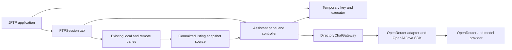
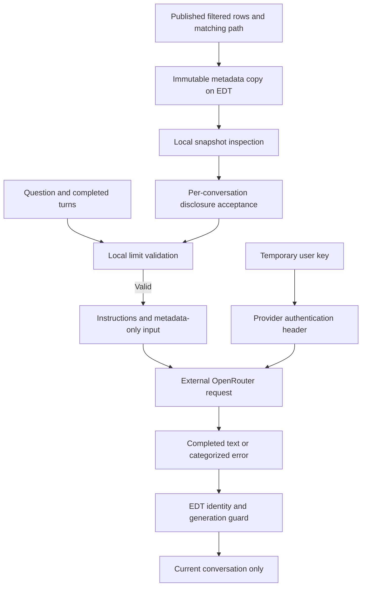
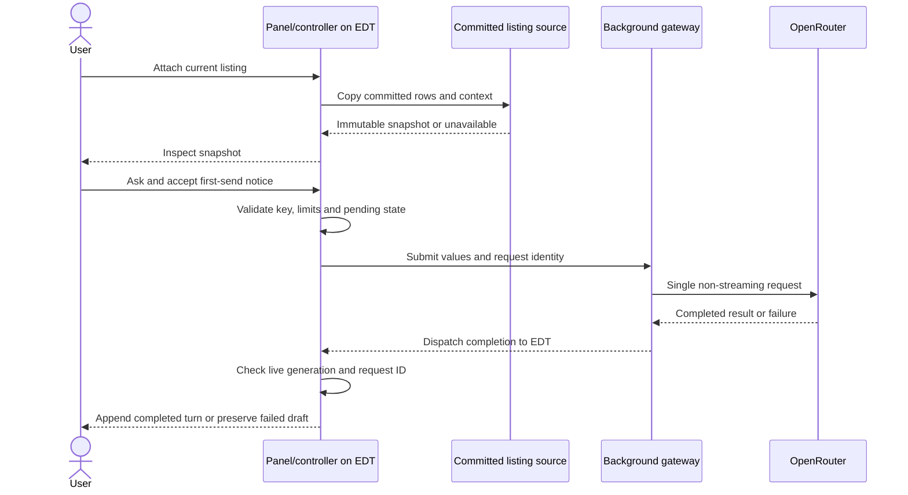
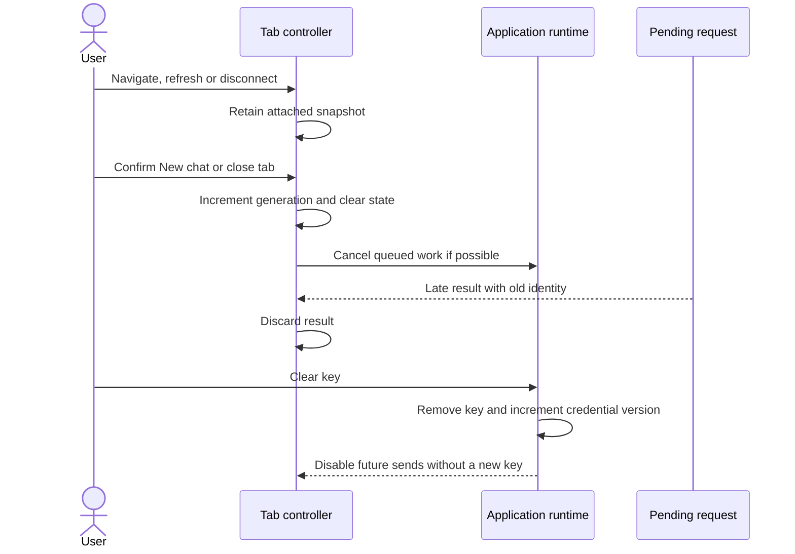

# ADR-006: Directory assistant — desktop architecture and implementation plan

**Date:** 2026-10-30  
**Status:** Accepted design direction using recommended defaults authorized by the user; implementation and runtime verification pending.  
**PRD:** [Directory assistant PoC](../prd/directory-assistant.md)  
**Related:** [Provider integration](007-directory-assistant-provider.md), [baseline architecture](000-main-architecture.md), [Java platform target](004-java25-platform.md).

## 1. Overview

Add metadata-only directory Q&A to the current Swing application. The user authorized proceeding with recommendations instead of repeating the unanswered architecture questionnaire. This record adopts an in-process integration, the current Java 8 compilation target, non-streaming answers, temporary state, and a small manual pilot. It does not claim those choices were individually answered in the questionnaire.

The feature is feasible as an additive panel/controller/service boundary. No broad FTPSession rewrite, transport replacement, database, backend, application login, or Java platform migration is required. OpenRouter still requires the user's API key: no application authentication does not mean unauthenticated provider access.

### Verified feasibility and required local refactoring

| Current evidence | Consequence |
|---|---|
| `pom.xml` declares compiler release 8; installed course JDK is newer. ADR-004 describes a future Java 25 target, not the default build. | Keep release 8 for this feature. Use framework-neutral Java-compatible SDK artifacts; do not infer compatibility from the installed JDK alone. |
| `FTPSession.java:289-307` constructs the paired panes and log split. | Add the collapsible assistant alongside this workspace; retain the existing header, actions, log and status. |
| `LocalPane.java:115-141` and `RemotePane.java:107-131` publish sorted model arrays and expose their mutable backing data. | Add a narrow immutable listing-copy boundary; never hand those arrays to AI code. Current sorting mutates model data rather than using a row sorter. Copy displayed row order; account for view/model conversion if sorting changes later. |
| `FTPSession.java:346-369,400-443` changes working-directory fields in workers before publishing UI rows; failed remote listings can publish empty data. | Do not combine a current session path with arbitrary old rows. Publish a matching path/filter/readiness record with the rows and distinguish successful empty results from failed loads. |
| `JFTP.java:154-159,194-218` creates tab sessions and closes them before removal/exit. | Give each tab its own controller and invalidate it at close; keep the key at application lifetime. |
| `JFTP.java:518-557` persists preferences; existing favorites can contain FTP credentials. | Keep all AI state outside persisted preference/profile graphs. Never supply a RemoteHost or preferences object to the provider adapter. |
| `com/myjavaworld/gui/SwingWorker.java` posts completion on the EDT but has legacy interruption behavior. | Isolate new AI work from FTP workers and busy flags. Use an assistant-owned executor and explicit completion dispatch to the EDT. |
| `src/main/assembly/binary.xml` includes transitive dependencies in the distribution. | SDK dependency packaging fits the current distribution layout; verify the extracted launcher with all transitive JARs. |

These are source observations, not a new successful build or desktop run. LocalFile caches basic metadata at construction; use cached values represented by the published listing rather than rereading file contents or issuing new listings. The earlier navigation map's historical test counts are not current counts. Original definitions and callers, not generated snapshots, informed this assessment.

## 2. Technology Documentation References

| Technology | Verified Context7 ID or official reference | Use |
|---|---|---|
| OpenAI Java | `/openai/openai-java`; [official Java reference](https://developers.openai.com/api/reference/java) | Framework-neutral SDK, Java floor and configuration |
| OpenRouter | `/openrouterteam/docs`; [Responses overview](https://openrouter.ai/docs/api_reference/responses/overview) | Direct external inference; details in ADR-007 |
| AG-UI | `/ag-ui-protocol/ag-ui`; [Java overview](https://github.com/ag-ui-protocol/ag-ui/blob/main/docs/sdk/java/overview.mdx) | Evaluated protocol alternative, deferred |
| Swing concurrency | [Swing threading policy](https://docs.oracle.com/en/java/javase/25/docs/api/java.desktop/javax/swing/package-summary.html#threading) | EDT ownership; implementation must use APIs available at release 8 |

IDs were resolved in this session. OpenAI Java and AG-UI queries succeeded. Further Context7 queries hit the monthly quota; delegated official-source research filled the identified gaps. ADR-007 records the resulting comparison and exact versions. No verified Context7 ID is invented for the other alternatives.

## 3. System Architecture

### Architecture pattern and stack

Keep a single desktop process. Swing owns presentation and conversation state; a provider-neutral request boundary performs background inference. The AI adapter receives values only and has no file or FTP operation capabilities.

| Layer | Choice | Reason |
|---|---|---|
| Application/runtime | Existing Swing/Maven application, compiler release 8 | Avoid coupling the experiment to ADR-004 migration |
| Presentation | Collapsible Swing panel per FTPSession | Fits existing session/tab lifetime |
| Work scheduling | Application-owned executor, two workers and eight waiting slots | Bounds concurrent AI requests without blocking browsing |
| AI integration | Official OpenAI Java SDK through an OpenRouter-specific adapter | Java 8-compatible documented surface; full contract in ADR-007 |
| Storage/auth | No database or application login; temporary key and conversations | Matches internal PoC scope |

New production classes live under the application package's `assistant` area, separated into presentation/controller, value models, and provider adapter. Corresponding tests use the existing application test root. Keep existing FTP and ZIP packages intact. The current binary assembly remains the distribution artifact; adding AI dependencies requires auditing its resulting `lib` contents.

## 4. Module Structure & Dependencies

- **AssistantPanel:** renders settings, snapshot inspection, messages, pending/error states and reset confirmation. It emits user intents to its controller and never invokes a provider or FTP API directly.
- **AssistantController:** per-tab state machine; owns conversation, draft, notice acceptance, request identity and generation. It validates user intents and renders state only on the EDT.
- **ListingSnapshotSource:** narrow integration with local/remote pane publication. It exposes an immutable copy of the committed displayed listing, path, applied filter description and readiness. It has no listing, download or refresh operation.
- **AssistantRuntime:** application-scoped ephemeral key holder, fixed provider configuration and bounded executor. It creates/disposes per-request provider clients and shuts down on application exit.
- **DirectoryChatGateway:** provider-neutral request/result boundary implemented by the OpenRouter adapter from ADR-007. It depends on request values and the SDK, never on FTPSession, FTPClient, RemoteHost, file handles or Swing components.

Dependency direction: application composition → controller/panel/snapshot source; controller → runtime and gateway contracts; adapter → SDK. Value models have no UI, SDK or FTP dependencies. Do not create a plugin framework, event bus or circular references between adapter and controller.

The listing publication change is a focused refactor: preserve existing browsing behavior, characterize it before editing, and add a readiness record rather than extracting all connection or transfer logic. For each pane, mark capture unavailable when its listing work begins; publish rows and their matching context together on success; leave capture unavailable on failure. Disconnect/reconnect invalidates remote readiness until a successful listing from the current connection. An empty successful listing is ready. Cover every existing caller that replaces rows, including post-transfer refreshes; document caller coverage during implementation.

## 5. Data Models

| Value | Fields and conceptual types | Lifetime |
|---|---|---|
| PublishedListing | pane kind; path text; filter description; successful-load flag; connection/listing generation; ordered entries | Pane-owned committed state, replaced on publication |
| EntryMetadata | literal name; kind/type text; size in bytes if supplied; last-modified value and display text if supplied; optional attributes | Immutable snapshot values; no LocalFile/RemoteFile references |
| DirectorySnapshot | unique ID; local/remote kind; path; capture instant; filter description; immutable ordered entry list | One per conversation, until reset/close |
| Conversation | unique ID; monotonically increasing generation; snapshot; ordered completed turns; pending question/error; disclosure flag | Per tab, memory only |
| ChatTurn | user question text; completed assistant text | Append atomically only after a valid completed response |
| RequestIdentity | conversation ID; generation; unique request ID | One pending request per tab |
| CredentialState | application-held key; version counter | Until clear, replacement or exit; never serialized |

Unknown metadata remains absent, not fabricated. Preserve raw supplied sizes without treating directory size as recursive content size. Date formatting follows the pane's existing display; do not invent a server timezone. The snapshot contains all displayed entries except `.` and `..`, irrespective of selected rows. Snapshot capture uses cached row metadata and never follows links or invokes file-content access.

## 6. API / Interface Contracts

| Boundary | Input | Output and failures |
|---|---|---|
| Capture listing | Chosen pane in the current tab; called on EDT | Immutable snapshot or explicit not-ready/over-limit error. No external request. |
| Submit question | Snapshot, completed turns, draft, accepted notice and available key | One pending request or validation/capacity error preserving the draft |
| Gateway analyze | Immutable chat request and current key supplied for this call | Completed answer or categorized failure; no callbacks into Swing |
| Complete request | Identity and gateway result, dispatched to EDT | Apply only if controller is alive and identity/generation still match; otherwise discard |
| New chat / tab close | Explicit reset confirmation, or tab lifecycle close | Increment generation, cancel queued work where possible, clear context and release references |
| Clear key | Application action | Remove held key; block future sends across tabs; existing submitted work may finish |

Controller states are empty, snapshot-ready, pending, failed and closed. Reset returns to empty. A failed draft remains editable; Retry sends it once without duplicating history. Pending work prevents another send in that tab. Queue saturation reports temporary capacity unavailability and retains the draft without sending.

AI work must not call the existing session-wide busy setter or FTP abort operation. Existing pane navigation and manual transfers remain usable. Closing a tab invalidates responses even if its network request cannot be stopped. Collapsing the panel has no lifecycle effect. Key clearing/replacement cannot revoke a key already delivered to a provider; release a per-call client after completion and never reuse it for a later send.

Wire application shutdown into JFTP.exit: first invalidate/close every assistant controller, then stop the runtime accepting submissions, cancel queued work, request active-call cancellation and executor shutdown, and clear the held key before the existing preference-save/dispose sequence. Use daemon executor workers and do not wait for network termination on the EDT. SDK resource closure must still occur on worker completion; cancellation does not promise that external inference or charges stop. Selected-tab close invalidates only that tab, without shutting down the shared runtime.

## 7. Environment Variables

| Variable | Purpose | Required | Example |
|---|---|---|---|
| None | Users enter the key through assistant settings; model and endpoint are fixed application configuration | No | Not applicable |

Do not read OPENAI_API_KEY or OPENAI_BASE_URL implicitly. No hidden environment-based provider switch is supported. Normal Java/Maven build environment setup continues as documented in the repository. The team changes the pinned default model through a reviewed configuration/resource change, not an end-user setting or live model catalog.

## 8. Technical Decisions

### Add the assistant without a platform migration

**Status:** Accepted. **Date:** 2026-10-30.  
**Context:** The application still targets release 8; Java 25 is an independently gated plan. The selected SDK documents a Java 8 runtime floor.  
**Decision:** Preserve the current target and desktop workflows; add the narrow publication/controller/gateway boundaries above.  
**Rejected alternatives:** Broad FTPSession rewrite adds unrelated regression risk. Requiring Java 25 would delay the usefulness experiment.  
**Consequences:** (+) Smaller implementation scope. (-) New code cannot use records, virtual threads or JDK HttpClient. Java 8 source/bytecode compatibility is retained; this does not certify the whole distribution on an untested Java 8 installation.  
**Review trigger:** ADR-004 lands with native acceptance, or an essential dependency raises its runtime floor.

### Direct desktop inference, completed answers and temporary state

**Status:** Accepted. **Date:** 2026-10-30.  
**Context:** The experiment needs one metadata chat, not a shared agent platform. Users already supply their own keys.  
**Decision:** Call OpenRouter from the desktop, show completed answers, and retain no AI state across launches.  
**Rejected alternatives:** Local helper/shared service adds deployment and lifecycle work. Streaming adds partial-answer states. AG-UI adds a protocol layer without supplying the model client or Swing widgets.  
**Consequences:** (+) No backend hosting or app login. (-) Every workstation needs network access and the user's key; full history is resent and centralized provider policy enforcement is absent.  
**Review trigger:** Shared billing, centrally managed credentials, agent-driven actions, reusable streaming backends, or centralized policy become approved requirements.

### Separate UI ownership from async work

**Status:** Accepted. **Date:** 2026-10-30.  
**Context:** Listing arrays and session paths can change independently during legacy worker operations. Responses can arrive after a tab closes or a chat resets.  
**Decision:** Copy committed listing values on the EDT, run HTTP on the assistant executor, and accept completion only for a matching live request identity.  
**Rejected alternatives:** Reading mutable session objects from worker threads creates mismatched context. Reusing FTP busy/abort state couples independent operations.  
**Consequences:** (+) Stable context and late-response isolation. (-) Requires a small publication-readiness refactor across existing row-update callers.  
**Review trigger:** A later approved design introduces live context updates or agent file actions.

## 9. Diagrams

### 9.1 Components

### 9.2 Data flow and trust boundary

### 9.3 Capture and question

### 9.4 Navigation, reset, close and key clearing

## 10. Testing Strategy and Implementation Plan

### TDD and layers

| Layer | Scope | Approach |
|---|---|---|
| Unit | Snapshot copying, controller transitions, limits, late-result guards, credential lifetime | JUnit Jupiter 5.14.4, matching the existing Vintage version; mock all dependencies at this layer |
| Integration | Real pane publication/controller/gateway composition and SDK mapping | Real application components; only the external LLM boundary may be mocked, using freshly captured synthetic responses as required by ADR-007 |
| E2E/native | Packaged Swing app, real local files, real FTP/FTPS fixtures and OpenRouter | No mocks; actual user-entered test key, synthetic metadata and screenshot/byte evidence |

Add the Jupiter aggregate test dependency at 5.14.4, matching the existing Vintage engine version in the POM; verify artifact resolution and combined discovery with the existing Surefire setup in the first gate. Do not migrate the existing JUnit 4 suite as unrelated work. Read the repository's java-junit skill before adding tests, and retain discovery of all legacy cases. The selected Jupiter dependency has not been resolved during this documentation task.

First characterize pane publication, filter refresh, failed/empty listing distinctions and tab-close behavior. Get characterization tests green and demonstrate that a controlled mutation breaks a critical assertion, then revert it. For new behavior, write failing tests, confirm the intended failure, implement the minimum, and rerun the changed scope. Never weaken old assertions to fit the refactor.

### Ordered implementation slices

1. **Dependency and protocol feasibility gate:** Resolve the pinned SDK and inspect its dependency tree, compile the adapter surface under release 8, and run the real synthetic OpenRouter compatibility capture defined in ADR-007. A failed gate blocks SDK-dependent implementation; do not hide it behind invented fixtures or a silent transport switch.
2. **Published listings and values:** Add characterization coverage, then immutable snapshots and readiness/path coherence. Cover local/remote filters, sorting, empty results, failed loads, in-progress navigation and reconnect to a different host.
3. **Temporary runtime/controller:** Add tests first for one pending question per tab, queue saturation, failed-draft retry, key clear/replacement, tab isolation, reset/close and late completions. Implement the gateway and state transitions without UI file actions.
4. **Swing UI:** Add the collapsible panel, settings, snapshot inspection, notice and confirmation states. Keep rendered output as plain text rather than interpreted HTML or actionable links. Ensure loading the AI client does not trigger a request.
5. **Packaging and verification:** Use the repository wrapper's test/package routes and extracted Windows launcher from README. Update any retained direct-source baseline runner's dependency list/classpath for the SDK or explicitly migrate that runner to the Maven-resolved classpath; leaving it unable to compile current sources is not acceptable. Refresh affected RepoMap, graph, Repomix packs and evidence after captured source/POM changes, preserving frozen history.
6. **Native acceptance and pilot:** Run the real flow described below, then a small manual pilot. No implementation is part of this ADR task.

### Key scenarios and native evidence

Exercise attach without FTP, remote attach after a real listing, filtered/sorted capture, successful empty listing, missing key, notice cancel/accept, follow-up, ambiguous question, unavailable contents, transfer request refusal, real successful answer, service failure, manual retry, reset/close during a delayed response, two independent tabs, key clear and clean relaunch. Verify that no request starts on attach/key entry and that assistant actions change no file bytes.

Start the actual packaged application, select its real window, perform one action and reobserve before the next. Use Computer Use/native Windows UI tooling supported in the current session or human verification; process metadata/headless tests do not complete acceptance. Save every touched screen under `docs/testing/screenshots/`, compare against JSystems reference assets, and verify manual FTP upload/download still preserves bytes. Use synthetic fixtures and isolated profiles. Record build, test discovery counts/skips, startup and native flows separately. If desktop or a live-key prerequisite is unavailable, identify the unverified flows rather than calling the feature complete.

### Technical acceptance criteria

- **TAC-006-01:** The normal build still compiles application sources with release 8 and includes all SDK runtime dependencies in the extracted distribution.
- **TAC-006-02:** Capture contains ordered immutable values matching one successful published path/filter generation and cannot relist or read file contents.
- **TAC-006-03:** A failed or pending remote listing cannot be attached as a successful empty snapshot.
- **TAC-006-04:** All snapshot reads and UI/state updates occur on the EDT; provider calls occur outside it.
- **TAC-006-05:** Reset or close invalidates pending identity before any subsequent response can update the UI.
- **TAC-006-06:** A tab has at most one pending request; the executor admits at most two running and eight waiting requests.
- **TAC-006-07:** Persisted preferences, favorites and application logs contain no newly introduced AI key, conversation or snapshot data after the synthetic acceptance flow.
- **TAC-006-08:** The package launches and completes local/remote metadata Q&A and existing manual transfers on the actual desktop, with screenshots and transferred-byte evidence.

### Usefulness pilot

After technical acceptance, ask five volunteer trainers/participants to try five directory questions each on synthetic course listings. Record task completion, whether the answer was supported by metadata, and willingness to use the feature again in a manually maintained pilot note; do not build telemetry. Recommend expansion only if at least four participants report a useful answer, at least three would use it again, and no observed file mutation or credential disclosure occurs. These are decision thresholds for the experiment, not promises of model accuracy or statistical significance. Keep file-content analysis and agent transfers in later PRDs regardless of pilot enthusiasm.
