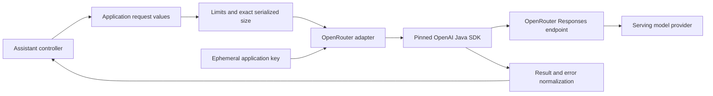
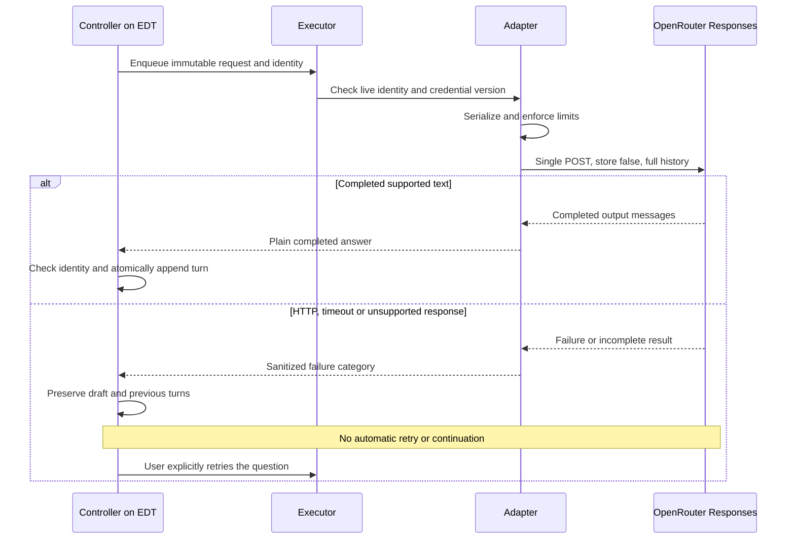

# ADR-007: Directory assistant — LLM options and OpenRouter contract

**Date:** 2026-10-30  
**Status:** Accepted design direction; SDK/provider compatibility and native acceptance pending.  
**Relates to:** [ADR-006 architecture and plan](006-directory-assistant-architecture.md)  
**PRD:** [Directory assistant](../prd/directory-assistant.md)

## 1. Scope

Choose the LLM integration for a Java Swing, metadata-only PoC. Compare the requested OpenAI Java SDK, OpenRouter Responses API, and AG-UI Java, then define a single provider contract, limits, errors, credential handling and validation gates. This does not implement a backend, agent tools, file transfers, application authorization, or streaming UI.

## 2. Technology Documentation References

Checked on 2026-10-30. Context7 resolved the first three IDs; OpenAI Java and AG-UI documentation queries succeeded. OpenRouter queries then failed with the monthly quota message. The user was informed, and focused internet research was delegated to Luna using official sources. The same quota prevented further Context7 lookups for alternatives; only publisher documentation is used below.

| Technology | Verified ID or official documentation | Used for |
|---|---|---|
| OpenAI Java SDK | `/openai/openai-java`; [Java reference](https://developers.openai.com/api/reference/java), [releases](https://github.com/openai/openai-java/releases), [SDK configuration](https://github.com/openai/openai-java) | Java floor, pinned artifact, base URL, retries and timeout |
| OpenRouter | `/openrouterteam/docs`; [Responses overview](https://openrouter.ai/docs/api_reference/responses/overview), [basic usage](https://openrouter.ai/docs/api_reference/responses/basic-usage) | Endpoint, stateless history and response envelopes |
| OpenRouter model | [GPT-4.1 Mini](https://openrouter.ai/openai/gpt-4.1-mini), [public model metadata](https://openrouter.ai/api/v1/models) | Default model availability and published capabilities |
| AG-UI | `/ag-ui-protocol/ag-ui`; [introduction](https://docs.ag-ui.com/introduction), [Java overview](https://github.com/ag-ui-protocol/ag-ui/blob/main/docs/sdk/java/overview.mdx) | Protocol scope and community Java modules |
| LangChain4j | [Getting started](https://docs.langchain4j.dev/get-started/) | Alternative Java orchestration library; no verified Context7 ID |
| Spring AI | [Getting started](https://docs.spring.io/spring-ai/reference/getting-started.html) | Alternative Spring-based integration; no verified Context7 ID |
| JDK HTTP | [JDK HttpClient](https://docs.oracle.com/en/java/javase/25/docs/api/java.net.http/java/net/http/HttpClient.html), [HttpsURLConnection](https://docs.oracle.com/en/java/javase/25/docs/api/java.base/javax/net/ssl/HttpsURLConnection.html) | Direct HTTP alternatives; HttpClient is available since Java 11 |

The OpenAI SDK's configurable string model ID is documented in its [Responses parameter source](https://github.com/openai/openai-java/blob/main/openai-java-core/src/main/kotlin/com/openai/models/responses/ResponseCreateParams.kt). This supports an expected integration path; it does not certify OpenRouter compatibility.

## 3. Component Design and Feasibility Comparison

These options occupy different layers: an SDK calls an API; OpenRouter supplies the service/API; AG-UI standardizes communication between an agent backend and a UI. They are not interchangeable libraries.

| Option | Current evidence | Changes needed in this application | Decision |
|---|---|---|---|
| Official OpenAI Java SDK | Version 4.94.0 shown by official docs/releases; framework-neutral artifacts document Java 8+. Configurable base URL and string model IDs. Automatic retries default to two. | Add the SDK and transitive dependencies, isolate behind a gateway, override retries/timeouts, validate third-party response parsing and package dependencies. No compiler-target migration required by its documented floor. | Select `com.openai:openai-java:4.94.0` for this PoC, subject to the explicit compatibility gate. |
| OpenRouter Responses API | OpenAI-compatible HTTPS endpoint; stateless. This is an API, not a Java library. Documentation does not state a maturity guarantee; some OpenRouter SDKs use a beta namespace. | Keep history locally and send it each time; map status/output/error envelopes; use the user's OpenRouter key. | Select the Responses endpoint requested for evaluation. Do not label it stable or beta without stronger evidence. |
| AG-UI Java | Community-maintained SDK, Java 17+. Core/client/server artifacts 0.1.1; HTTP/SSE client. Jackson serializer module `ag-ui-spring-server-core` 4.1.0 is documented as not requiring Spring itself. | Raise the runtime baseline to at least 17 for in-process use, create/host an AG-UI agent endpoint or equivalent bridge, add event reduction and Swing rendering. Still needs an LLM integration. | Defer: adds a protocol/server boundary without a current product need. No supplied Swing chat widget. |
| LangChain4j | Official getting-started documentation shows 1.23.0 and JDK 17+. Supports provider abstraction and higher-level AI Services. | Raise baseline to at least 17 or introduce a separate process; add framework dependencies and provider configuration. | Viable after a runtime migration; defer until approved tools/RAG/multiple-provider orchestration justify it. |
| Spring AI | Official documentation shows the 2.0.x line supporting Spring Boot 4.0.x/4.1.x. The sources consulted do not establish its exact minimum JVM, so none is asserted here. | Adopt a compatible Spring/Boot runtime and configuration/dependency lifecycle, in-process or as a separate service. Verify JVM requirements before selection. | Defer: a larger stack than this desktop call boundary requires. |
| Direct HTTP + JSON | JDK HttpClient requires Java 11+; HttpsURLConnection is an older API available to release-8 code. Neither is a JSON parser or conversation framework. | On release 8 use HttpsURLConnection plus a maintained JSON library, implementing errors/timeouts/response parsing; after migration JDK HttpClient is available. | Realistic low-abstraction alternative, but not selected: duplicates SDK transport/mapping work. Revisit if the pinned SDK fails the compatibility gate. |

Latest-version documentation is not proof that an artifact resolves in this environment or that every transitive dependency works with JFTP. No dependency was added, JAR compatibility probe executed, real inference submitted, or runtime upgrade performed during this documentation task. The selected version is a reproducible pin, not an instruction to automatically use future latest releases.

The provider adapter is the only component importing SDK types. It builds a fresh per-call client with the fixed endpoint, current application-held key, no automatic retries and bounded timeout. It returns application-owned result values and closes/releases its call resources. It does not use environment-derived SDK defaults, FTP TLS/trust overrides, persistent provider sessions, tool execution, provider model selection UI or SDK wire logging.

## 4. Data Structures and Product Limits

### Provider request

The request consists of the fixed model identifier, metadata-only assistant instructions, the full attached snapshot as structured serialized text, all completed user/assistant turns in order, and the current question once. Snapshot data is explicitly labeled untrusted evidence rather than instructions. It includes only the pane kind, path, capture time, filter description and allowed entry metadata from ADR-006. Provider authentication is separate from conversational content.

Keep application history as simple user/assistant text. Do not replay provider-specific output items as executable instructions or store provider response IDs for continuation. Send the snapshot once per request, not repeatedly inside every previous turn.

Map the fixed behavior policy to the Responses request's instructions field. Input starts with one user-role item containing the labeled serialized snapshot, followed by the completed user/assistant messages in order and one final user-role question. No filename or user-supplied text can become an instructions field or privileged role. Preserve text boundaries through structured serialization rather than constructing messages by concatenating unescaped fragments.

### Chosen PoC defaults

| Setting | Value | Meaning |
|---|---|---|
| Endpoint | `https://openrouter.ai/api/v1/responses` | Fixed HTTPS destination; no arbitrary endpoint UI |
| SDK base URL | `https://openrouter.ai/api/v1` | SDK adds the Responses resource path |
| Model | `openai/gpt-4.1-mini` | Single team-controlled default; no live model catalog or automatic model fallback |
| Streaming | Disabled | Display a completed answer only |
| Provider response storage | `store` false; no `previous_response_id` | OpenRouter rejects `store: true` and non-null previous response identifiers |
| Automatic application/SDK retries | Zero | User initiates each retry; no hidden fallback request |
| Request deadline | 60 seconds from worker execution start | Includes connection/read work, excludes time waiting in the application executor |
| Snapshot entries | At most 500, after excluding navigation rows | Reject an oversized attachment; do not silently omit entries |
| Question length | 1–4,000 Unicode code points after checking for non-whitespace content | Preserve entered text; reject a whitespace-only or oversized question |
| Conversation | At most 10 successful question/answer turns | After ten completed turns, require New chat before another send; failed sends do not consume a turn |
| Serialized request body | At most 65,536 UTF-8 bytes | Measure the actual body including instructions/history/escaping before network submission; reject, never truncate |
| Output allowance | `max_output_tokens` 1,024 | Product budget cap, not a guarantee of an answer's completeness |

These are chosen product limits, not claims about OpenRouter quotas or the model's maximum capacity. Official model metadata lists a much larger context and text input/output; this PoC intentionally uses a smaller budget. Availability, prices and provider terms can change. Do not show a guaranteed cost estimate or claim that limiting output alone fixes total spend. Full-history resubmission also incurs input usage.

Enforce the actual serialized-body limit in the adapter's pre-network request stage, using SDK-supported request serialization/transport hooks if needed. A controller-side estimate alone is insufficient for the 65,536-byte contract. Verify the hook during the dependency gate. A provider context rejection remains possible and is shown without retry even after local limits pass.

### Provider result

Success contains plain answer text and optional non-secret provider request identifier for diagnostics. Failure contains a category, sanitized user-facing message and optional retry-after information. Neither includes the API key, raw request body, raw exception dump, or metadata-bearing provider error details.

## 5. Interface Contracts

### Analyze directory request

**Input:** Immutable snapshot, completed turns, current question, request identity and key supplied by the application at dispatch. All local limits and per-conversation disclosure acceptance must pass first. Before queued work starts, recheck that the request is still live and the credential version unchanged; otherwise return a local canceled/key-changed state without sending. Do not hold an obsolete key copy in queued tasks.

**Transport:** One authenticated non-streaming request to the fixed Responses endpoint. Send no tools, tool choice, external connectors, file attachments, file identifiers, browsing capabilities, model fallback list or automatic truncation. Use ordinary HTTPS certificate verification independent of legacy FTP trust overrides. Requests carry full local conversation history, with `store` false and no previous response ID. Provider-internal routing is governed by OpenRouter, and is not an application model-switch feature.

**Successful output:** Require a completed response with no reported top-level error. Collect text from all message output items' `output_text` segments in their returned order; do not assume a top-level text field or that the first output item is text. Render text literally. Refusal content, if returned as such, is displayed as a refusal rather than described as analysis. A completed refusal can be a completed conversational turn; no tools are executed.

**Incomplete or unsupported output:** A non-completed status, reported error, empty usable output, unrecognized required structure, or tool-call-only output produces an explicit unsupported/incomplete response error. Preserve the draft and previous turns; do not append partial text as a completed answer. No automatic continuation request occurs after the output limit is reached. Exact SDK status/refusal handling must be established from real captures and the pinned SDK's documented models before adding fixtures; OpenRouter's examples alone do not establish every shape.

### Failure categories

| Condition | Application behavior |
|---|---|
| Missing/cleared key, context absent, notice declined, local limit, capacity unavailable | Send nothing; explain the prerequisite and retain the draft |
| HTTP 401 | Invalid/rejected key; offer settings; never echo the key |
| HTTP 402 | Credit or spending-limit failure; do not assert the account balance is necessarily zero |
| HTTP 403 | Access/policy denial as reported; do not retry automatically |
| HTTP 429 | Rate/capacity limit; show any supplied retry-after instruction and require manual retry |
| HTTP 400 or context rejection | Invalid request or context limit where identified; show a sanitized corrective message |
| HTTP 408, local timeout or network failure | Explain timeout/connectivity failure; retain draft; provider work/charges may already have occurred |
| HTTP 5xx or unavailable provider/model | Service unavailable; retain draft and require manual retry; do not substitute another model |
| Malformed, incomplete, unsupported or empty response | Explain that no completed supported answer was received; retain draft |
| Other/unknown failure | Generic request-failed message; do not invent a cause |

Sanitize diagnostics by allowlisting category/status, elapsed time and a provider request identifier when supplied. Do not log request/response bodies, headers, key, filenames, paths or chat text. An application-issued identifier can correlate a failure without storing conversation data.

### Credential lifetime

Use a masked password field. Copy its entered characters into a dedicated nonpersistent application key holder; clear replaced/removed buffers and release references on exit. The SDK may internally create immutable strings, so this is best-effort reference cleanup, not a promise of forensic memory erasure. Clear the input field after applying the key. No preference field, favorite, environment export, clipboard write, bundled key or shared proxy credential is introduced. A per-call client must not outlive its active request.

## 6. Technical Decisions

### Official SDK with an OpenRouter-specific boundary

**Status:** Accepted, compatibility gate pending. **Date:** 2026-10-30.  
**Context:** The official Java SDK supports a custom base URL/string model identifier and documents Java 8-compatible framework-neutral artifacts. Its models primarily represent OpenAI, so third-party compatibility needs evidence.  
**Decision:** Pin OpenAI Java 4.94.0 behind DirectoryChatGateway and use the OpenRouter Responses subset above. Disable its default retries and override its default timeout.  
**Rejected alternatives:** Direct HTTP is feasible but requires custom transport/mapping. LangChain4j/Spring AI add runtime/framework scope. AG-UI solves a different boundary and cannot replace provider inference.  
**Consequences:** (+) Maintained SDK types and transport. (-) Kotlin/Jackson/HTTP transitive dependencies increase distribution size and may expose provider-schema differences. Resolve and inspect them before integrating with the full app.  
**Review trigger:** The real compatibility capture fails, required serialization/timeout controls are unavailable, or an essential dependency no longer supports the retained target. Stop and revise this decision explicitly; do not silently switch endpoints or transports.

### Stateless requests with one small text model

**Status:** Accepted. **Date:** 2026-10-30.  
**Context:** The user wants a fixed model and temporary conversation state. OpenRouter's Responses API requires full-history requests and rejects stored continuations.  
**Decision:** Use `openai/gpt-4.1-mini`, replay completed plain-text turns and the snapshot, disable storage/streaming/tools, and apply the local limits above.  
**Rejected alternatives:** Server-stored continuation is unsupported by the selected API. Long-running agents and automatic model fallback are beyond the PRD. Chat Completions is a viable simpler API surface but is not selected alongside Responses; supporting two APIs adds unnecessary paths.  
**Consequences:** (+) Predictable local state and one bounded integration path. (-) Repeated input costs and a ten-turn ceiling; no guarantee of factual accuracy merely from disabling tools.  
**Review trigger:** Model removal, unacceptable pilot answer quality/cost, or an approved need for tools/content access. Update the single team default through review, not automatic runtime substitution.

### Capability restriction over prompt-only promises

**Status:** Accepted. **Date:** 2026-10-30.  
**Context:** Filenames can contain instructions and models can infer unsupported contents. Prompting alone does not guarantee grounded answers.  
**Decision:** Supply only values, expose no tools/actions, render plain text, and instruct the model to cite literal entry names, qualify inferences and ask clarification. Treat answer quality as an acceptance/pilot question rather than a security boundary supplied by the model.  
**Rejected alternatives:** Passing live session/client objects gives unnecessary authority. Rendering executable HTML or attaching clickable file actions contradicts the read-only PoC.  
**Consequences:** (+) The assistant cannot invoke file actions through this integration even when prompted. (-) It can still produce incorrect text, which requires explicit evaluation and limitation messaging.  
**Review trigger:** Any future tool or transfer capability requires a new approved contract and its own authorization flow.

## 7. Diagrams

### Provider components



### Single send, error and manual retry



### Key replacement during queued or active work

```mermaid
sequenceDiagram
    actor User
    participant Key as Key holder
    participant Queue as Queued request
    participant Active as Active provider call
    User->>Key: Clear or replace key
    Key->>Key: Increment version and release old held value
    Queue->>Key: Check version immediately before dispatch
    Key-->>Queue: Version changed or unavailable
    Queue->>Queue: Do not send; retain editable question
    Note over Active: Already submitted work may still complete
    Active->>Active: Close client and release key references on completion
```

## 8. Testing Strategy

### First dependency and real-service gate

Before feature implementation, resolve the pinned Maven artifact using the project's wrapper and inspect the effective dependency tree for Java floor, Jackson/HTTP conflicts, duplicate versions and distribution inclusion. Compile the intended SDK adapter surface with release 8 and verify SDK retries, deadline and exact-body validation controls. SDK documentation is not a substitute for this probe. Do not update the whole build or unrelated dependencies to conceal an incompatibility.

Before creating any LLM endpoint mock, make a fresh authorized real request using synthetic names and questions and a deliberately supplied test key. Capture the complete HTTP status, response headers and body verbatim, ensuring the response contains no secrets; do not capture the authorization header or request key. Record date, endpoint, model, SDK version and sanitized synthetic request separately. Use restricted ignored local evidence if response headers include account-linked identifiers; never commit credentials or confidential metadata. Derive fixtures from that response, not from documentation examples.

A key was not supplied and no paid request was made for this ADR. Live SDK/OpenRouter compatibility, provider failure shapes, artifact resolution and native behavior therefore remain unverified prerequisites. If a safe live capture cannot be obtained, report the missing key/service prerequisite and stop mock creation. Never invent an error response to satisfy a test plan. Obtain a separate real capture before mocking a materially different response shape; do not intentionally create billable account-limit failures or change account settings without authorization.

### Test scenarios

| Scenario | Type | Input | Expected result / edge cases |
|---|---|---|---|
| Request construction | Unit | Synthetic snapshot and prior turns | Snapshot once, ordered completed turns, current draft once, fixed endpoint/model, store false, no tools or credentials in content |
| Product limits | Unit | 500/501 entries, 4,000/4,001 code points, 10 completed turns, UTF-8 body at/over 65,536 bytes | Accept boundaries, reject excess before network, preserve text without truncation; include emoji, non-ASCII names and JSON escaping |
| SDK controls | Unit/integration | Pinned SDK client configuration | No retry, bounded call lifetime and actual serialized-body guard; verify no hidden environment fallback |
| Parse captured output | Unit | Fresh real synthetic response fixture | Collect all supported message text; preserve literal filenames; no actions for tool-like or instruction-like text |
| Incomplete/unsupported output | Unit/integration | A captured applicable response or application-owned gateway failure | No partial success appended; editable draft preserved; if no safe capture, report the endpoint-fixture gap |
| Error mapping | Unit/integration | Captured service failure or real timeout/network condition | Sanitized category and retry hint, no raw payload logging, no automatic resend |
| Retry and credential version | Unit | Failed question, explicit retry, key replaced while queued | One question per request/history, obsolete queued key never sent |
| Prompt injection and grounding | Live E2E | Synthetic filenames containing instructions; requests for contents/transfers | No file/network tools; answer uses metadata or explains the limit; record factual errors rather than weakening assertions |
| Packaging and native flow | Real app E2E | Extracted distribution, synthetic local/FTP listings and test key | Complete question/follow-up, failure recovery and isolated tabs; existing transfer bytes unchanged |

Unit tests may mock dependencies; integration tests use real internal components and may mock only the external LLM API using fresh captured shapes. Native E2E uses no mocks. Follow the repository TDD, Java test skill and native evidence requirements in ADR-006. Run discovery counts/skips honestly and record missing external prerequisites rather than silently skipping them.

### Technical acceptance criteria

- **TAC-007-01:** The pinned SDK resolves and its selected API surface compiles with the unchanged release-8 target.
- **TAC-007-02:** A real synthetic OpenRouter response is captured and successfully mapped by the pinned SDK before endpoint mocks are created.
- **TAC-007-03:** Each user send/retry causes at most one application-submitted HTTP inference request with automatic retries disabled.
- **TAC-007-04:** Locally rejected input produces zero provider requests and loses no draft or snapshot data.
- **TAC-007-05:** The request contains store false, no previous response ID and no tools, and uses only the fixed model and endpoint.
- **TAC-007-06:** Every submitted serialized body respects the byte cap; any returned incomplete/unsupported result remains a failure rather than a completed turn.
- **TAC-007-07:** Provider work runs outside the EDT, returns within the configured call deadline or reports timeout, and releases per-call resources.
- **TAC-007-08:** Synthetic acceptance logs and persisted files contain no AI key, request/response body, filename, path or chat transcript introduced by this feature.
