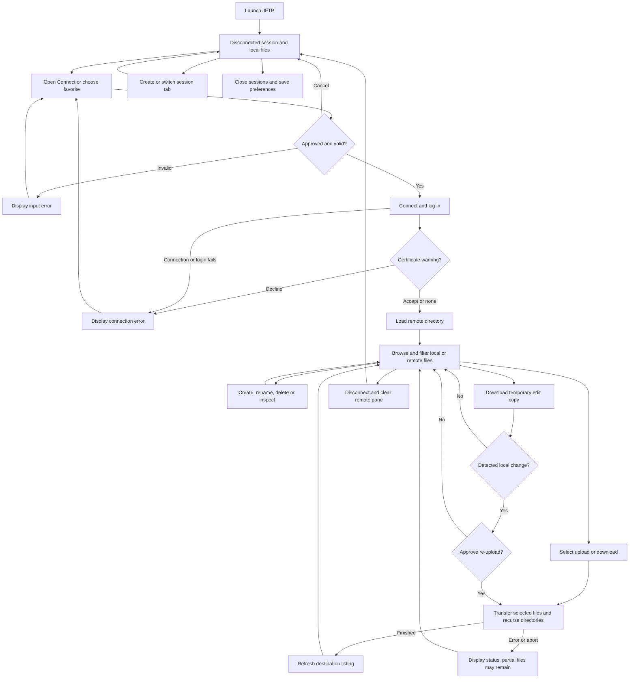

# PRD — JFTP current application

**Date:** 2026-10-29  
**Status:** AS-IS description, derived from source; desktop and live-server confirmation pending.  
**Baseline:** application source at `14e62ceba4e371c2a0b955604b10f065f46f4f7d`. Documentation and context tools added since that revision do not change the application.

## 1. Executive summary

JFTP is an existing desktop FTP/FTPS client for people who browse local and remote directories and transfer files between them. This document records the application's current user-visible behavior before modernization. It describes the implemented paths, including limitations; it does not certify that those paths work on the present machine or every server.

Evidence references **CS-xx** resolve in the [current-state evidence register](current-state-evidence.md). All acceptance criteria below are source-derived baseline expectations, awaiting runtime confirmation. Personas describe plausible users of the implemented features, not findings from user research.

## 2. Problem statement

People working with an FTP server need to find files on both machines, select the correct transfer direction, and see connection and transfer failures. Repeated connections also require the same host settings and credentials. The existing application combines these activities in a desktop workspace; its historical documentation alone does not establish which features remain usable today.

## 3. Users and personas

| Persona | Task | Expected outcome |
|---|---|---|
| Site maintainer | Upload a selected set of local files or directories | Files reach the selected remote directory and its listing refreshes |
| File recipient | Download files from a remote FTP site | Files appear under the selected local directory with visible progress or errors |
| Repeat operator | Reuse connection profiles and work in several sessions | Each tab retains its own connection/workspace while preferences apply across the application |

The repository does not establish actual active users, accessibility needs, typical file sizes, or which historical features are still used. Those remain open, without blocking this factual inventory.

## 4. Main flows

### 4.1 Open the application and choose a workspace

1. Launching the desktop entry point opens the main window and creates a disconnected session tab.
2. The session shows local files, a remote workspace, a status/log area and a transfer status bar.
3. The local directory comes from preferences; an unavailable or non-directory location falls back to the operating system's default directory.
4. The operator can create additional session tabs, switch tabs and close the selected tab. Exiting closes sessions and attempts to retain window preferences. Existing tab connections are not described as restart-persistent sessions. [CS-01, CS-02, CS-03, CS-04]

### 4.2 Connect, browse and reconnect

1. The operator opens Connect and supplies host, user, password and port. An account, initial directories, passive mode, connection/listing choices and post-login commands are available.
2. For empty initial values the dialog fills the user with `anonymous` and the password with the configured email address.
3. The operator chooses plain FTP, encryption if available, explicit FTPS or implicit FTPS. Plain FTP and passive mode are the initial defaults.
4. Empty host/user/password fields and out-of-range ports prevent approval and produce an error focused on the affected field/tab. The current port validation accepts zero as well as 1–65535; zero must not be described as a normal usable server port.
5. Cancelling the dialog does not initiate a connection. Approving it starts connection/login, then configured commands, initial remote directory selection and directory listing.
6. A successful connected state updates the remote pane and tab title. Failures are reported through existing dialogs/log paths; there is no guarantee of a uniform recovery state for every failure.
7. Connecting again while already connected asks for confirmation. Reconnect reuses the most recently retained host settings in that session. Disconnect clears its remote display after the disconnect worker finishes. [CS-05, CS-06, CS-07, CS-08]

### 4.3 Transfer files and directories

1. The operator selects remote entries and Download, or local entries and Upload. With no connection or no selection, the top-level transfer action returns without transferring.
2. Selected entries are processed in order within the session. Directories are processed recursively, excluding the special `.` and `..` entries. Active filters affect recursive traversal.
3. A transfer uses automatic extension-based type selection or the explicitly selected type. Unknown extensions fall back to the configured default; that default initially is binary.
4. The status area exposes the current operation, transferred bytes/progress, elapsed time and speed. After the top-level operation completes, the destination listing refreshes.
5. Abort requests cancellation and prevents further recursive/selected work when the abort flag is checked. It does not roll back files already written.
6. Download As and Upload As provide a different destination name. ZIP-and-upload and download-and-unzip are separate convenience flows.
7. Ordinary download requests non-append output, which the inspected dependency implements by overwriting the destination file. The inspected ordinary upload path requests replacement storage from byte zero; the server can still reject it. No conflict-resolution prompt was found in these ordinary transfer paths. Partial files after cancellation or failure are possible. [CS-09, CS-10, CS-11, CS-12, CS-13; dependency evidence D-01]

### 4.4 Filter, manage and inspect files

The operator can apply name-pattern and modification-date filters, choose inclusion/exclusion, and control hidden local files. Directory traversal remains available even when regular-file filters reject names. Local hidden-file filtering has an unusual interaction with exclusion mode: a hidden entry rejected by the hidden-file condition is accepted when exclusion is selected. This is recorded behavior, not a recommended rule. [CS-14, D-02]

Local and remote actions include create file/directory, rename, delete and properties. Deleting selected files requires confirmation; directory deletion can recurse. Remote permissions use server commands and therefore depend on server support and the logged-in account. A visible command is not proof that a server supports it. [CS-15, CS-16]

### 4.5 View or edit a remote file

1. The operator selects a remote regular file and invokes an applicable view/edit action.
2. The application downloads a temporary local copy and asks the operating system to open the applicable viewer/editor where supported.
3. Editing registers the temporary copy for change monitoring. A detected change prompts the operator before uploading the changed copy back.
4. Declining that prompt leaves the remote file unchanged by that notification. Failed download or unavailable desktop integration can prevent opening; the application does not include a guaranteed built-in editor. [CS-17, CS-18]

### 4.6 Reuse profiles and preferences

Favorites retain named host connection profiles and can reconnect to a selected profile. Their stored profile data includes connection credentials; this is not a promise of secure password storage. Preferences cover connection defaults, file types, presentation, local directory, proxy and certificate-store settings. They are shared application settings rather than per-tab settings. [CS-19, CS-20, CS-21]

On startup, the enabled-by-default update check waits briefly and requests version information. It displays an informational message for a newer version; the inspected path does not install a new application binary. A failed request prints an error and retries after five minutes. [CS-22]

## 5. User stories

- As a site maintainer, I want to upload the selected local entries so that I can publish them to the currently selected remote directory.
- As a file recipient, I want to download a directory recursively so that its selected contents are available locally.
- As an operator, I want invalid connection fields identified before connection so that I can correct them.
- As an operator, I want connection and transfer failures displayed so that I can decide whether to retry, disconnect or change settings.
- As a repeat operator, I want named favorites so that I can reuse host settings.
- As an operator working with several sites, I want separate tabs so that switching workspaces does not replace every other session.
- As a remote editor user, I want a prompt before a detected local edit is uploaded so that I can choose whether to replace the remote content.

## 6. Acceptance criteria

These describe the observed source contract. They are not a claim that an automated or manual acceptance run has passed.

| ID | Current observable expectation | Evidence |
|---|---|---|
| AC-01 | Desktop startup creates and selects one disconnected session tab. | CS-01, CS-02 |
| AC-02 | An invalid saved initial local directory falls back to the system default directory. | CS-03 |
| AC-03 | Creating another session adds a separate selectable tab. | CS-02 |
| AC-04 | Approving Connect with a blank host, user or password displays the corresponding validation error. | CS-05 |
| AC-05 | Connect rejects port values below zero or above 65535. | CS-05 |
| AC-06 | Cancelling Connect returns no approved host for connection. | CS-06 |
| AC-07 | Successful connection/login and listing populate the remote pane when the client remains connected. | CS-07 |
| AC-08 | Reconnect uses the retained host settings when such settings exist. | CS-08 |
| AC-09 | Download with no selected remote entries performs no transfer. | CS-09 |
| AC-10 | Upload with no selected local entries performs no transfer. | CS-10 |
| AC-11 | Directory transfer skips entries named `.` and `..`. | CS-09, CS-10 |
| AC-12 | An unmapped extension in automatic mode uses the configured default transfer type. | CS-11 |
| AC-13 | An accepted delete confirmation starts deletion; declining it leaves that action unstarted. | CS-15, CS-16 |
| AC-14 | Applying a local or remote filter requests a refresh of that pane. | CS-14 |
| AC-15 | A detected change to a monitored edit prompts before re-upload. | CS-18 |
| AC-16 | Declining the changed-file prompt does not start its upload. | CS-18 |
| AC-17 | Disconnect completion clears the remote pane and resets transfer status. | CS-08 |
| AC-18 | Exiting attempts to save the current window bounds in preferences. | CS-04 |
| AC-19 | A fresh preferences object selects passive plain FTP and binary default transfer. | CS-20 |
| AC-20 | Ordinary download opens the destination in non-append mode, replacing its previous content when opening succeeds. | CS-09, D-01 |
| AC-21 | An invalid/unrecognized server certificate can cause a warning that permits an explicit operator override. | CS-23 |
| AC-22 | A successful update-information request does not itself install a replacement application binary. | CS-22 |

## 7. Out of scope for this description

- **Unobserved deployments:** server compatibility, operating-system support and historical release claims are not certified by reading the source.
- **Other protocols:** no SFTP/SSH, HTTP file service, cloud drive or server administration workflow is established by this inventory.
- **Ancillary completeness:** JavaHelp content, every popup, applet hosting and obsolete macOS integration are inventoried technically but not exhaustively specified screen by screen here.
- **New behavior:** branding changes, dependency upgrades, security fixes and refactoring are future work; none are acceptance requirements for the AS-IS application.
- **Usage analytics and guarantees:** no real-user research, throughput target, availability SLA or supported maximum file size is established.

## 8. Constraints

The operator needs access to a compatible FTP/FTPS server and appropriate server/file permissions. Some remote operations, directory formats, encrypted connections and desktop edit/view associations depend on the server, runtime and operating system. A valid-looking connection form does not establish reachability or authentication success.

English, German and Traditional Chinese resource roots exist; translation completeness has not been exercised. The original language choice follows saved/default locale. English-only work in this modernization session is a project instruction, not evidence that the historical product had no other languages. [CS-01, CS-20, CS-24]

No numeric maximum file size or concurrency guarantee is established. Large-transfer progress, interrupted writes and recursive handling need runtime confirmation. Current certificate warnings and retained credentials are documented limitations, not guarantees of modern transport or storage security. The [architecture record](ADR/000-main-architecture.md) explains those technical constraints.

## 9. UI description

### Main workspace

The top menu groups FTP, Local System, Remote System, Transfer Types, Tools and Help. A toolbar sits above selectable session tabs. Each session places a scrollable status/log panel above a horizontal local/remote split and a status bar below. Each file pane includes directory navigation and a file table; selection determines which actions apply. A fresh session is disconnected and has no established remote listing. Busy operations update status; failures can appear in logs or dialogs. This is a source-derived wireframe, not a screenshot of a running instance. [CS-02, CS-03, CS-25]

### Connection and favorites dialogs

Connect groups connection fields and advanced/security choices, with approval/cancel actions. Validation retains the dialog and focuses the affected input. Favorites presents saved connection entries and actions to manage or connect with an entry. Security warnings can interrupt an encrypted connection and require an operator choice. [CS-05, CS-06, CS-19, CS-23]

### Preferences, filters and file dialogs

Preferences groups application and connection defaults. Filter dialogs configure matching conditions and inclusion/exclusion. Rename/create dialogs collect names; properties expose metadata and applicable remote permissions. These return to the selected session after approval or cancellation. Exact rendered controls, keyboard behavior, disabled states and error wording still need native UI confirmation. [CS-14, CS-15, CS-16, CS-21]

## 10. User flow diagram

## 11. Agent/system behavior

No in-product LLM or AI-agent behavior was identified in the inspected application. Repository agent skills and context tools assist development; they are not JFTP runtime features.

## 12. Further notes and self-answered intake

The user explicitly requested autonomous answers instead of a questionnaire and requested both PRD and ADR before major changes.

| Intake question | Evidence-based answer |
|---|---|
| Who uses the product today? | Actual users are unknown. The implemented workflows support the three operational personas above. |
| What happens after the principal action? | A connection populates the remote pane; top-level transfers refresh the destination listing. Failure paths can leave partial state. |
| What does this document omit? | Live compatibility certification and ancillary screen completeness; see section 7. |
| How are invalid or ambiguous outcomes handled? | Field validation prevents approval; network/server errors use existing dialog/log paths. There is no single proven recovery guarantee. |
| What external constraints matter? | Server capabilities/permissions, desktop associations, runtime transport support and potentially destructive destination writes. |
| What does the current UI look like structurally? | Menu/toolbar/tabs, log above two file panes, status below, supporting dialogs; see section 9. |
| Which features are dead or known wrong? | The startup license call is commented out. Other unused features cannot be identified from source presence alone; usage is unknown. |

Future work requested by the user is to retain the Java desktop application, establish a regression baseline, modernize incrementally and apply the supplied JSystems brand, including a logo on the right. These requests need separate change criteria and technical decisions; they must not be mistaken for already existing behavior. Native screenshots and controlled-server observations should later supplement, rather than silently overwrite, this dated baseline.
