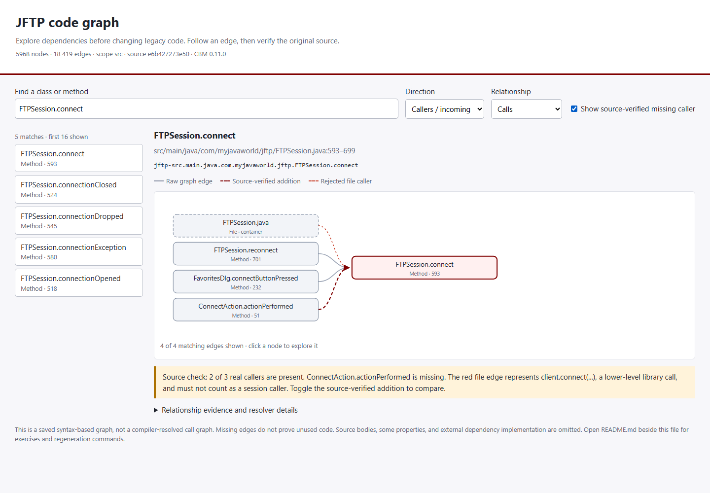

# JFTP code graph course example

Open **[jftp-code-graph.html](jftp-code-graph.html)** in a browser. It is a self-contained offline viewer: no server, Java build, downloaded graph tool, JavaScript library, API key, or network request is needed to explore the committed snapshot. The accompanying [JSON snapshot](jftp-code-graph.json) is available for queries and other visualizers.



From the repository root, this opens the saved viewer in your default browser:

```sh
python tools/code_graph.py view
```

## Explore the graph

The initial selection is `FTPSession.connect`, with incoming `CALLS` relationships. Search for a class or method, select a result, and click nodes to navigate. Change the direction or relationship to inspect outgoing calls, imports, inheritance, or ownership. The diagram displays up to 32 relationships per selection; the full exported dataset remains available to the CLI. Long result sets are deliberately bounded to keep a neighborhood readable.

Expand **Relationship evidence and resolver details** to inspect call-site lines, strategy, and confidence where the original graph recorded them. A confidence number and the strategy label `lsp_type_dispatch` do not mean javac or Eclipse JDT resolved the reference.

## A graph result that needs source review

The saved Windows CBM 0.11.0 graph finds two concrete callers of `FTPSession.connect(RemoteHost)`:

| Source caller | Original call site | Raw graph result |
| --- | --- | --- |
| `ConnectAction.actionPerformed` | `src/main/java/com/myjavaworld/jftp/actions/ConnectAction.java:73` | Missing edge |
| `FavoritesDlg.connectButtonPressed` | `src/main/java/com/myjavaworld/jftp/FavoritesDlg.java:249` | Present |
| `FTPSession.reconnect` | `src/main/java/com/myjavaworld/jftp/FTPSession.java:703` | Present |

It also reports a `CALLS` edge from the synthetic `FTPSession.java.__file__` node. The cited line 649 is `client.connect(remoteHost.getHostName(), port)`, a call to the external FTP library, not the session entry. The viewer marks that edge red. The **Show source-verified missing caller** toggle adds the missing `ConnectAction` relationship as a separately labeled overlay. It does not alter the raw graph or quietly hide its error.

These four source checks, their exact quotations and SHA-256 hashes are committed in [verification.json](verification.json). Other graph relationships have not been individually verified. This is a navigation and evidence example, not a Java runtime correctness test or an exhaustive security review.

## Query the committed snapshot without installing CBM

```sh
python tools/code_graph.py verify
python tools/code_graph.py search FTPSession.connect --label Method --limit 5
python tools/code_graph.py callers FTPSession.connect --limit 10
python tools/code_graph.py callees FTPSession.connect --limit 20
python tools/check_source_evidence.py docs/code-graph/verification.json
```

Search returns exact qualified names, labels, and original source locations. Caller/callee queries inspect one hop of raw `CALLS` edges and keep synthetic nodes visible. Ambiguous symbols require an exact qualified name from search. For a modification, inspect original receiver types, bodies, listeners, reflection, resources, and dependency wiring before relying on the answer.

## Rebuild from source

Python 3.12 or newer is required. Setup downloads the pinned official CBM release, verifies the archive checksum, retains its license/notices, and keeps it under `~/.jftp-code-graph/tools/0.11.0/`. It does not execute the vendor installer or register client integrations.

```sh
python tools/code_graph.py setup
python tools/code_graph.py index
python tools/code_graph.py export --replace
python tools/code_graph.py verify
```

Setup is online; indexing and export use local source. The helper sets a dedicated cache and runtime under `~/.jftp-code-graph/`, restricts indexing to this checkout's `src`, and disables auto-indexing and watchers. The custom runtime avoids the AppData ancestor-ACL conflict observed on the author's Windows machine without changing that machine's ACLs. Existing CBM sessions use account-level coordination: do not stop or replace another session to resolve a conflict.

Windows x86-64 setup/export and the committed snapshot are the tested course route. Platform archive selection is included for Linux and macOS but those setup routes have not been exercised for this example. The exporter targets the pinned version's SQLite schema; changing CBM versions requires reviewing that schema and the CLI again.

If an existing state directory is rejected because its DACL grants mutation rights
to another identity, use a fresh private directory owned by the current account.
The verified executable remains in the original installation. The refresh for this
snapshot used this route without changing ACLs or stopping another session:

```powershell
$env:JFTP_GRAPH_STATE = Join-Path $env:USERPROFILE '.jftp-code-graph-current'
python tools/code_graph.py index
python tools/code_graph.py export --replace
```

Use the same override for later live queries. It must be an absolute path. Omitting
it retains the original default state location; offline snapshot queries need no
running native service. Three CLI configuration tests cover default/override paths
and rejection of relative state paths (`tests/test_code_graph_state.py`).

For live graph queries after indexing, use the native tool through the same environment:

```sh
python tools/code_graph.py live list_projects --format json --detail stats
python tools/code_graph.py live index_status --project jftp-src --diagnostics summary --format json
python tools/code_graph.py live trace_path --project jftp-src --function-name jftp-src.main.java.com.myjavaworld.jftp.FTPSession.connect --direction inbound --depth 1 --limit 20 --include-evidence true --format json
```

The optional native UI is separate from the offline course viewer:

```sh
python tools/code_graph.py native-view
# Open http://127.0.0.1:9749 in your browser.
python tools/code_graph.py stop
```

`native-view` deliberately starts a persistent, local viewer daemon. Stop it when finished. Snapshot browsing, verification, and offline queries start no service. Do not run the native tool's `install` command merely to inspect this example.

## Snapshot scope and limitations

- Source scope: `src`, refreshed at base HEAD `e6b427273e5037136a780ff516a27d3fb68fbf04`, including working-tree tests and launcher updates. The full source manifest identifies the actual indexed files; base HEAD alone does not identify uncommitted content.
- Tool: Codebase Memory 0.11.0, Windows x86-64; source release `8972ea69c6ad94b1ef1d4ffbf0a92d78d2db1798`.
- Dataset: 5,968 nodes and 18,419 relationships, including syntax-derived calls and structural/heuristic relationships.
- Retained: every indexed node/edge identity and type, source locations, and available call-site/resolver metadata. Source bodies and other node/edge properties, including machine-specific paths, are omitted.
- Source manifest: hashes for all 573 source-tree files. `verify` rejects added, removed, or changed source files and mismatched viewer/snapshot data. It permits Git CRLF/LF conversion in the declared source text extensions, while retaining original byte hashes; other content changes fail. Documentation-only commits can change `HEAD` without changing the indexed source revision, which is recorded separately from the export revision.
- Index diagnostics: 97 files deliberately not indexed, zero skipped files, four partial parses and zero unusable parses. The partial help files remain `remote/executeCommands.html`, `security/certificatesManager.html`, and `sessions/close.html` beneath `main/help/helpset/content/`; the fourth partial parse is the Maven-filtered `main/scripts/jftp.sh` template. Native ADR-presence hints apply to the indexed `src` subtree; the repository's ADRs are in `docs/ADR`.
- Coverage is best-effort. Reflection, callbacks, dependency implementations, and resource wiring still require original-source review. The Maven build has since been recovered, but this graph was not produced by a type-resolved compiler index.

CBM's release is [MIT licensed](https://github.com/DeusData/codebase-memory-mcp/blob/v0.11.0/LICENSE); executables and databases are not committed here. See the [pinned release](https://github.com/DeusData/codebase-memory-mcp/releases/tag/v0.11.0) and the bundled [graph workflow](../../.agents/skills/legacy-codebase-workflows/references/code-graphs.md).

## Validation

The offline viewer was checked in an isolated headless Chrome session at desktop and narrow-screen widths. Initial graph rendering, the verified overlay, node navigation, symbol search, outgoing ownership traversal, and narrow-screen layout passed, with no script errors or external network requests. Snapshot/hash checks and the four source citation checks also passed. These are tooling checks, not application transfer or desktop runtime tests.

## Participant exercise

1. Predict the callers of the session connection entry from the raw graph.
2. Read the four cited source lines and identify the missing and incorrect relationships.
3. Enable the source-verified overlay and explain why it is separate from extraction output.
4. Trace startup from `JFTPApplication.main`; inspect actual constructor and receiver bodies before accepting a graph path.
5. Propose a small signature change and list its concrete source callers, resource/reflection checks, external dependency boundary, and required behavior tests. A zero-degree node is not sufficient evidence for deletion.
