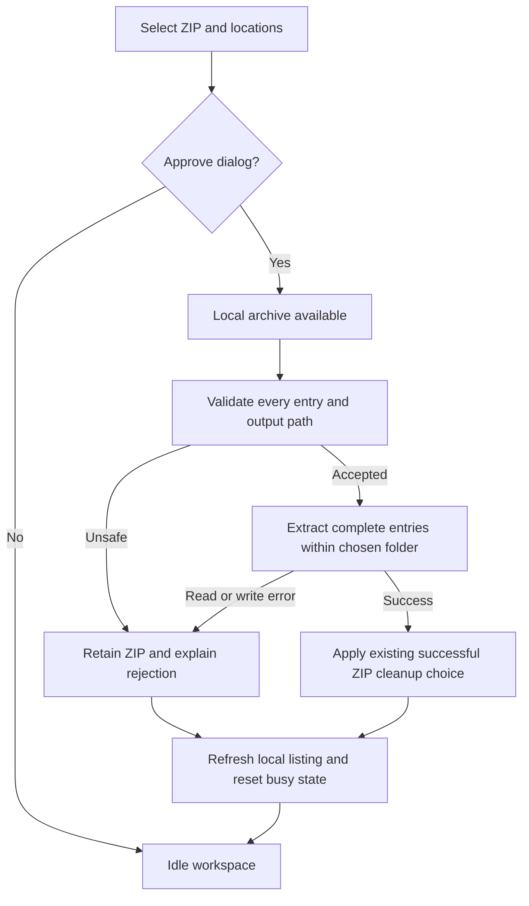

# PRD — Contained archive extraction

**Date:** 2026-10-30
**Status:** Planned security change under the autonomous modernization request;
not implemented or accepted by native QA.
**Baseline:** [Current application](../PRD.md), especially download-and-unzip;
source findings CS-12 and CS-31 in the [evidence register](../current-state-evidence.md).

## Purpose and current problem

Internal file operators use Download and Unzip to retrieve a ZIP and expand it
into a chosen local folder. This feature change prevents archive entry names or
existing filesystem links from directing extracted content outside that folder.
It preserves ordinary nested, empty, binary and Unicode files.

The current source uses archive entry names directly as output paths and can
overwrite existing files while extracting. It has no observed containment or
link guard. That is a source finding, not a successful malicious-archive UI test.
The downloaded ZIP's own chosen storage location is separate from the folder
where its entries are expanded.

## Users and stories

- As a file recipient, I want a normal ZIP expanded into my chosen folder so I
  can use its nested files without moving them individually.
- As an operator receiving an unfamiliar ZIP, I want unsafe names rejected so
  an archive cannot replace files outside the extraction folder.
- As an operator with existing output files, I want a failed entry read to leave
  the previous complete file intact.
- As an operator encountering an extraction error, I want an English explanation
  and a usable workspace so I can inspect retained files and decide what to do.

## Flows

1. Select a remote ZIP and open the existing Download and Unzip dialog.
2. Choose the archive storage location and an existing extraction folder.
3. Once the local ZIP is available, check all entry destinations before extracting.
4. For accepted entries, create nested directories and publish complete files.
   Existing ordinary files at those destinations may be replaced, as today.
5. Refresh the local listing and restore the workspace's idle controls.

If an entry name or an existing output path is unsafe, reject the archive before
creating or changing extracted files. Display the affected entry and reason.
Retain the downloaded ZIP for inspection even when temporary-download cleanup
would normally apply after success. Cancelling the dialog starts no work.

If reading or writing fails after validation, show an error and stop. Previously
completed entries may remain; the current file must not replace an older file
until its bytes have been read successfully. This is not whole-archive rollback.

## Acceptance criteria

| ID | Required result |
|---|---|
| Z-01 | Ordinary nested directories and binary, empty and Unicode files extract with their original names and exact bytes. |
| Z-02 | Parent-directory segments, rooted paths, drive/UNC paths and backslash entry names are rejected before any extracted output changes. |
| Z-03 | Empty or ambiguous path components, Windows device names, stream names, reserved filename characters and components ending in a dot or space are rejected with an English reason. |
| Z-04 | A destination that would traverse an existing symbolic link or redirected directory, or replace a symbolic-link file, is rejected before output changes. |
| Z-05 | A ZIP containing a valid entry followed by an unsafe entry leaves existing extraction-folder contents and outside sentinel files unchanged. |
| Z-06 | Replacing an existing ordinary destination file produces the new bytes inside the chosen folder without changing another name linked to the old file elsewhere. |
| Z-07 | A read or integrity failure does not replace an existing complete destination file or leave that entry's temporary output behind. |
| Z-08 | Validation failure retains the downloaded archive and reports the offending entry and reason; the local pane refreshes and busy controls return to idle. |
| Z-09 | The chosen extraction folder must already exist and be a directory; an invalid choice produces an error without creating extraction output. |
| Z-10 | Cancelling the dialog performs no download or extraction. |
| Z-11 | Duplicate file destinations, file/directory conflicts and attempts to overwrite the downloaded ZIP itself are rejected before extracted output changes. |

## UI and constraints

Keep the existing dialog's archive-location and extraction-folder choices and
its approve/cancel actions. Reuse the application's error presentation and
progress workspace. Errors identify the entry with escaped readable text;
they must not be interpreted as markup or change the operator's selection.

The selected existing folder may itself resolve to an operator-selected physical
location. Entry paths below that root must not redirect to another location.
Folder contents must not be concurrently renamed or replaced during extraction;
active local filesystem tampering is outside this change's guarantee.

ZIP names use forward slashes. Internal spaces and Unicode remain supported;
Windows-compatible restrictions apply consistently across supported platforms.
There is no new maximum archive size or throughput promise in this change.

## Out of scope

- **Other security boundaries:** FTPS trust, saved credentials and ordinary
  transfer destination rules require separate changes.
- **Archive features:** no new archive formats, password-protected ZIP support,
  symbolic-link creation, extraction cancellation or decompression resource quota.
- **Recovery:** no whole-archive transaction, automatic rollback of completed
  entries, or download retry policy.
- **Worker redesign:** propagation of download failures and the wider background
  worker/EDT contract remain separate work; containment applies to any local ZIP
  passed to extraction, including an incomplete one.
- **Other products:** no web interface, server administration or new protocols.

## Self-answered intake

The user explicitly delegated product/technical questions to this session.

The [technical design and implementation gates](../ADR/005-contained-archive-extraction.md)
define the planned enforcement and validation. Neither document claims the fix
has already shipped.

| Question | Decision |
|---|---|
| Who needs this change? | Existing internal file recipients using Download and Unzip. |
| What remains after success? | Extracted entries, the refreshed local pane and existing archive-cleanup choice. |
| What happens to unsafe input? | Reject the entire archive's output plan before changing extracted files; retain the ZIP and explain why. |
| Can existing files be replaced? | Yes, ordinary in-folder files may be replaced with a complete new entry; other links to old content remain unchanged. |
| What is the destination boundary? | The resolved existing extraction folder selected by the operator, not the ZIP's download location. |
| What is deliberately deferred? | Transport/download orchestration, archive resource limits, cancellation and whole-archive rollback. |
| What changes on screen? | Existing controls remain; validation and English error behavior become explicit. |

