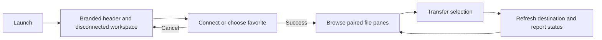

# PRD — JSystems desktop workspace

**Date:** 2026-10-29
**Status:** Approved scope from the user's autonomous modernization request; implementation pending.
**Baseline:** [Existing product](../PRD.md), [observed desktop transfers](../testing/native-ftp.md).

## Purpose and users

Keep the existing desktop FTP/FTPS client usable for internal file operators while
making its identity, navigation and file information consistent with JSystems.
Operators continue to work in session tabs with local and remote panes. This is
a change to the current application, not a replacement product.

## Main flows and stories

1. Launch the application. A branded header appears above the existing actions
   and a disconnected file workspace appears below it.
2. Open Connect or Favorites. Existing connection fields, approval/cancel behavior
   and saved profiles remain available.
3. Browse local and remote files and transfer a selection. The same destination
   listing and status/log feedback remain available after completion.
4. Add, switch and close session tabs. The header remains visible and each tab
   retains its separate workspace.

- As an internal operator, I want the supplied logo visible so I can identify the application.
- As a file operator, I want readable controls and file tables so I can distinguish selection and direction.
- As a repeat operator, I want existing connection profiles to remain available after the visual update.
- As an operator cancelling a connection, I want to return to the same disconnected workspace.
- As an English-speaking operator, I want generated file descriptions in English while actual filenames remain intact.

## Acceptance criteria

| ID | Required observable result |
|---|---|
| B-01 | The main workspace displays the supplied JSystems wordmark on the right of a persistent header, without distortion or cropping. |
| B-02 | The header identifies the application as JSystems FTP and describes the workspace as local and remote files. |
| B-03 | Workspace and dialog controls use the supplied visual reference, including burgundy emphasis, readable text, visible focus and clear selection. |
| B-04 | At a desktop width of 1000 pixels the header and file panes remain usable without overlapping the logo or hiding the session controls. |
| B-05 | Application-generated labels and local file type descriptions are English regardless of the Windows display language. Actual user filenames and paths are preserved. |
| B-06 | Launch still selects one disconnected tab, adding/closing a tab works, and cancelling Connect performs no network connection. |
| B-07 | Existing synthetic favorites and preferences remain readable without changing their stored format or credentials during the visual change. |
| B-08 | A real local test-server upload and binary download preserve bytes and update the destination panes under the new appearance. |
| B-09 | The appearance preferences identify the fixed JSystems theme instead of offering an alternative theme that startup ignores. |
| B-10 | Regional preferences show a fixed English language while retaining short/medium date and time style choices. Saving those styles leaves legacy locale data readable. |

## UI, constraints and scope

The main window retains its menu, action toolbar, selectable tabs, log, paired
file panes and progress/status area. The new header occupies a separate row above
the action toolbar. Supporting dialogs retain their current fields and workflows.
Visual values and the supplied asset reference are defined in the design guidance.

**Outside this change:** transport replacement, new protocols, trust-policy fixes,
credential-storage migration, archive security fixes and all-at-once worker
rewrites. They remain part of the overall modernization objective and require
separate behavior criteria. This visual step does not claim to secure legacy FTPS.

## Self-answered intake

The user requested autonomous decisions and already selected an incremental Java
desktop modernization and a right-side logo.

| Question | Decision |
|---|---|
| Who is this for? | Internal operators using the existing browsing and transfer workflows. |
| Which identity is supplied? | The repository's JSystems wordmark and website reference. |
| What remains after a transfer? | Existing destination refresh and log/status feedback. |
| How are errors handled? | Retain existing dialogs/log feedback in this visual step; no invented recovery guarantee. |
| How are old profiles handled? | Read the existing format and leave its security migration to a separate change. |
| What happens to appearance selection? | Use a fixed JSystems appearance for the internal product and label it truthfully. |

