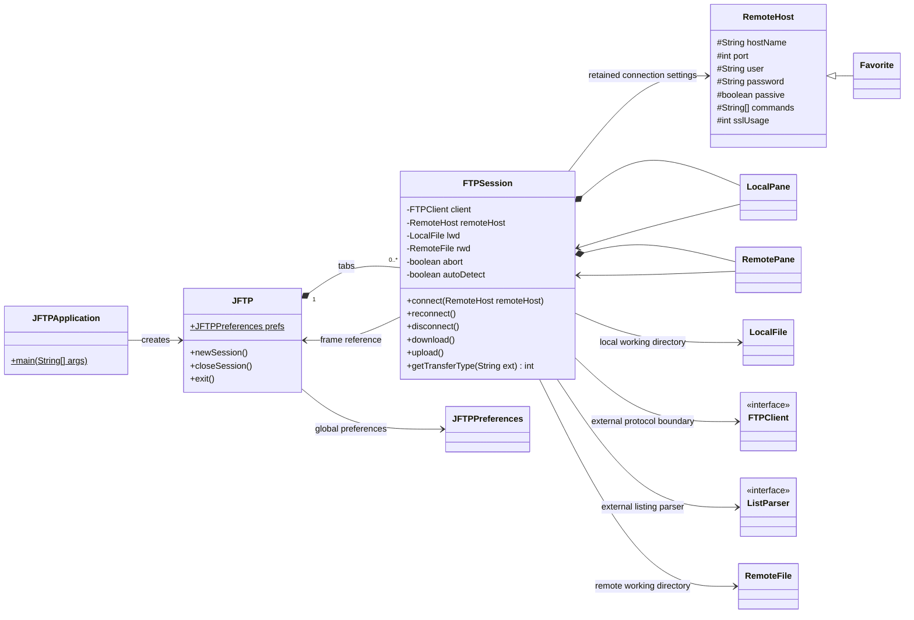
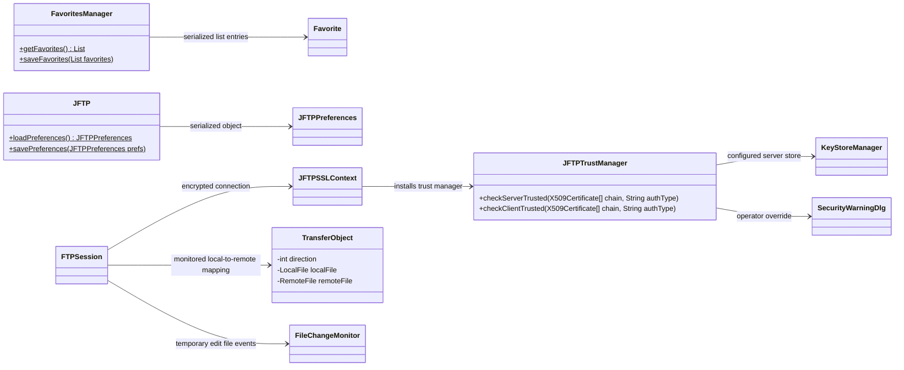
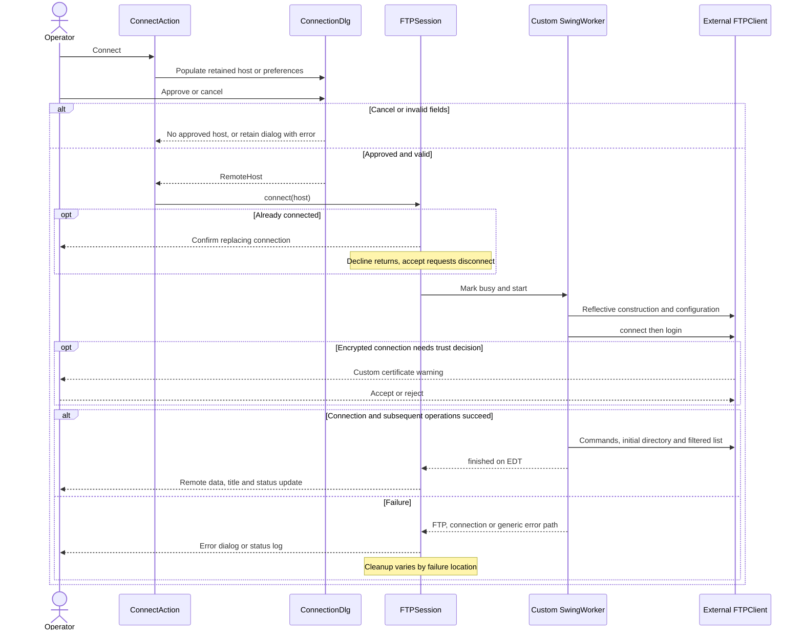
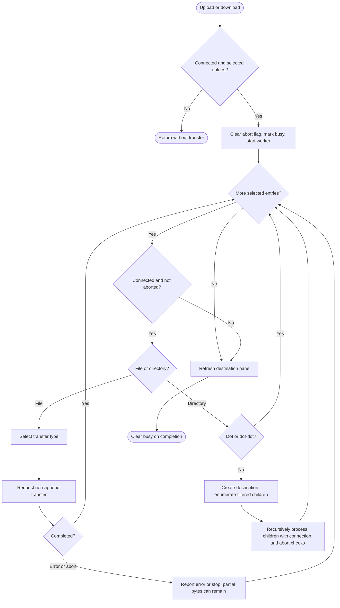
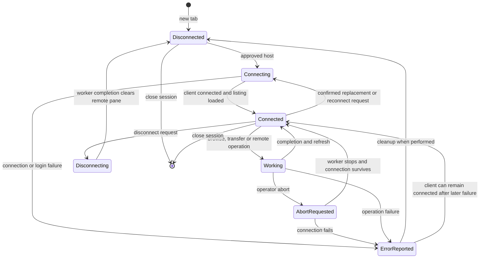
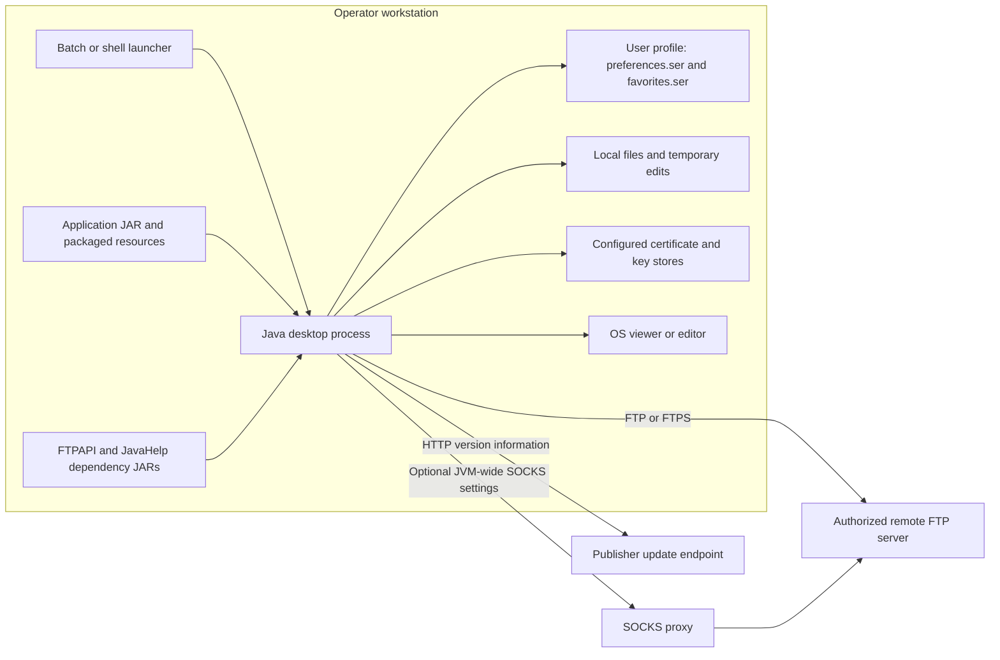

# JFTP UML views — current application

**Baseline:** application source `14e62ceba4e371c2a0b955604b10f065f46f4f7d`, examined 2026-10-29.

These selective views describe the existing Java desktop application. They are
source-derived, not a proposed redesign or proof of runtime success. Class diagrams
show selected members and relationships, not every declaration. The session state
diagram is an explanatory abstraction: the source uses client/busy/abort fields,
not a formal state-machine implementation. See the [PRD](../PRD.md),
[architecture ADR](../ADR/000-main-architecture.md), [verification gate](../ADR/001-baseline-verification.md)
and [source evidence](../current-state-evidence.md) for behavior, limitations and provenance.

GitHub renders the Mermaid blocks below. Open this file in a Markdown preview with
Mermaid support, or use the SVG links for viewers without Mermaid. The generated
SVGs reproduce these blocks; they do not require JavaScript or an internet connection.
The component/deployment view uses Mermaid flowchart notation because Mermaid has
no dedicated UML deployment grammar.

## 1. Core classes

[Open SVG](rendered/01-core-classes.svg). Evidence: CS-01–03, CS-07, CS-09–11, CS-26;
original declarations in `Favorite`, `LocalFile` and `TransferObject`.



`FTPClient`, `ListParser` and `RemoteFile` belong to the external FTPAPI dependency.
Reverse references deliberately show the current UI/session coupling. Reflection
and mutable global preferences are explained in ADR-000; no clean service layer is implied.

## 2. Persistence, TLS and temporary edits

[Open SVG](rendered/02-persistence-and-tls.svg). Evidence: CS-18–21, CS-23, CS-28, CS-30.



Favorites and preferences are object streams, not database entities. Favorites'
embedded-key cipher and legacy plaintext compatibility are observed mechanisms,
not a security endorsement. The custom server-trust method does not delegate PKIX
validation. The diagram must be read alongside ADR-000's trust/storage limitations.

## 3. Connection sequence

[Open SVG](rendered/03-connection-sequence.svg). Evidence: CS-05–08, CS-23, CS-27, CS-30.



The replacement-connection branch is simplified: disconnect is itself asynchronous.
This diagram does not claim the source safely serializes disconnect/reconnect.
Worker completion on the EDT does not make its background UI updates thread safe.

## 4. Transfer activity

[Open SVG](rendered/04-transfer-activity.svg). Evidence: CS-09–14 and D-01/D-02.



This activity is recursive and sequential within a session; it does not describe a
durable job queue or atomic transfer. Existing destination policy and server
rejections are documented in the PRD. Progress updates and error paths do not prove success.

## 5. Abstract session states

[Open SVG](rendered/05-session-states.svg). Evidence: CS-03, CS-07–10, CS-18 and abort action.



These states summarize observable branches. Busy, connection and abort flags are
separate mutable values and can overlap. There is no claim that every depicted
transition is guarded against races or that closing waits for all asynchronous work.

## 6. Deployment and external boundaries

[Open SVG](rendered/06-deployment.svg). Evidence: CS-19–24, CS-29–33.



This is the intended packaging topology implied by source. A full distribution has
not been built/launched yet. The assembly's root JAR location and the launchers'
`lib/` JAR path appear inconsistent; runtime deployment must be verified. No web
backend, database server or LLM service is established by the inspected application.

## Viewing, editing and validation

Edit the Mermaid blocks here and render them before committing. Keep diagram
changes tied to original definitions/callers and the evidence register. Architectural
improvements belong in a new dated ADR, rather than being drawn as existing classes.

The accompanying `validation.json` records the renderer version, diagram IDs,
source hash and SVG hashes for this snapshot. Rendering confirms Mermaid syntax,
not the application's behavior or the semantic completeness of these selective views.

To reproduce using Node.js, Chrome and an isolated ignored dependency directory:

```powershell
npm install --prefix .local/uml-qa --ignore-scripts --no-audit --no-fund mermaid@11.12.1 playwright@1.56.1
node tools/render_uml.cjs --write
node tools/render_uml.cjs --check
```

On other machines set `JFTP_CHROME` to the installed Chrome/Chromium executable.
The browser renders only the local diagram source and local Mermaid bundle.
`--check` validates each block in the browser and checks saved source/SVG hashes;
`--write` replaces generated SVGs, the first-diagram preview and validation receipt.
